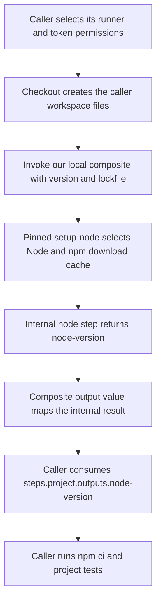

# 0051 · Create a composite action by composing pre-built actions

!!! note "Authored reference lesson"
    Build the team interface around maintained setup behavior. The action, inactive consumer, and file preflight are developed under `labs/0051/`. Predict failures before opening solutions; written content does not establish mastery.

## Prerequisites and goal

Read [0050 · Metadata and contracts](0050-own-action-metadata-and-contracts.md), including the distinction between a declaration and runtime validation. Recall [0001](0001-execution-model.md): checkout supplies local action files, and a composite invocation is a step in the caller's job. Keep the [module guide](create-your-own-action.md) and [local testing guide](../cheatsheet/local-testing.md) available.

Your goal is to trace a requested Node version and lockfile from the caller into setup-node, then trace the installed-version output back to the caller. You will also distinguish file preflight, static checks, remote setup execution, npm installation, and the actual project's tests. Run all local commands from the repository root.

## Define the small team policy

Suppose several repositories repeat the same setup convention: use Node 24 by default, key npm's download cache from a caller lockfile, and expose the installed version. The maintained setup action already acquires Node and integrates caching. A **composite action** can give that capability a smaller interface without writing a second installer.

The isolated package copies `examples/project-setup-action/action.yml` into `labs/0051/action/action.yml`. It introduces no shell script or custom language runtime:

```yaml title="labs/0051/action/action.yml"
name: Project Node setup
description: Configure the project's Node runtime and npm download cache through maintained actions.
inputs:
  node-version:
    description: Node version required by the caller.
    default: '24'
  cache-dependency-path:
    description: Lockfile path relative to the checked-out caller workspace.
    default: package-lock.json
outputs:
  node-version:
    description: The installed Node version.
    value: ${{ steps.node.outputs.node-version }} # (1)!
runs:
  using: composite
  steps:
    - uses: actions/setup-node@949feb2413d6458794dcd2491c4babbbce0c15c1 # v7.1.0
      id: node
      with:
        node-version: ${{ inputs.node-version }} # (2)!
        cache: npm
        cache-dependency-path: ${{ inputs.cache-dependency-path }}
```

1. Public output `node-version` maps the internal step `node`'s output. Identical spelling does not make the mapping automatic.
2. Composite inputs arrive through the `inputs` context. The explicit `with` mapping sends this value to setup-node; there is no automatically supplied composite `INPUT_NODE-VERSION` variable to read instead.

The quoted `'24'` is a version selector string; `node-version` returned by setup-node is the actual installed version, which may include a patch version and `v` prefix. Do not assert that the output equals the literal selector `24`. The current pinned [upstream metadata](https://github.com/actions/setup-node/blob/949feb2413d6458794dcd2491c4babbbce0c15c1/action.yml) declares these inputs and the installed-version output.



The composite is a useful naming and policy boundary, not a separate machine. It changes PATH and cache setup for subsequent steps in the same job through setup-node's runner integration. The version used to execute setup-node's own JavaScript action is its metadata runtime; the version it installs for later `node` commands is the requested project runtime. These can be different contracts even when both currently use Node 24.

## Trace the caller workspace

The full inactive recipe is `labs/0051/consumer.yml`. Its opening is:

```yaml title="Consumer excerpt: files before local action"
permissions:
  contents: read
jobs:
  setup:
    runs-on: ubuntu-latest
    timeout-minutes: 10
    steps:
      - uses: actions/checkout@3d3c42e5aac5ba805825da76410c181273ba90b1 # v7.0.1
        with:
          persist-credentials: false
      - id: project
        uses: ./labs/0051/action # (1)!
        with:
          node-version: '24'
          cache-dependency-path: package-lock.json # (2)!
```

1. The action directory must exist in the workspace before a repository-local invocation. The consumer YAML's own directory is not the lookup root.
2. This path selects a file in the caller's repository, not a file bundled inside the composite package. The root lockfile already exists; this lab does not create or modify shared dependency manifests.

A remotely referenced composite could be downloaded separately from the caller's checkout. Its definition would come from the action repository, while this lockfile would still come from the caller workspace. If you later add a helper script bundled with the composite, locate that script using the action's directory, such as `github.action_path`, rather than assuming it is in the caller root. [0026](0026-composite-shells-paths-and-portability.md) develops that path boundary.

**Prediction:** a caller checks out its repository into `source/`. Which paths in this excerpt must change?

??? tip "Worked prediction"
    The local package is now under `./source/labs/0051/action`, and the caller lockfile is `source/package-lock.json`. Project commands must also run in the checked-out project directory, for example through step `working-directory`. Changing the action path alone does not move the lockfile or the npm command's working directory.

## What the npm cache does and does not supply

The composite explicitly selects `cache: npm`, so setup-node hashes the chosen lockfile for npm download-cache behavior. A cache hit can avoid downloads; it is not evidence that project dependencies were installed or tests passed. Upstream's [README at this pin](https://github.com/actions/setup-node/blob/949feb2413d6458794dcd2491c4babbbce0c15c1/README.md#caching-global-packages-data) states that `node_modules` is not cached.

The caller therefore continues with an actual runtime assertion, `npm ci`, and `npm test`. These commands are project policy. Keeping them explicit avoids making a setup wrapper silently execute every repository's scripts. `npm ci` can access registries and run lifecycle scripts; reading or linting this recipe does not execute it, and it is not needed to run this module's host probes with already installed dependencies.

The recipe checks that the mapped output is nonempty and that `process.versions.node` has major version `24`. A later real integration run should observe both the output and the executable on PATH. A static check cannot prove a downloaded runtime was installed.

## Lab: preflight caller files, then inspect the interface

Before running the preflight, predict whether it needs a container daemon or a GitHub token:

```bash
uv run python labs/0051/preflight.py
```

Expected:

```text
FOUND: labs/0051/action/action.yml
FOUND: package-lock.json
PASS: caller files exist; setup-node and npm cache were not executed
```

The preflight only checks two paths. It is deliberately narrower than an action runner. It does not parse metadata, check output expressions, validate an npm lockfile's semantics, execute setup-node, or contact a cache service. Its successful exit proves those caller files exist at the selected workspace root.

For the static workflow boundary:

```bash
.tools/bin/actionlint labs/0051/consumer.yml
```

Expected: exit zero with no diagnostics for the unchanged recipe. This checks workflow structure, expression references, and supported local action interface information. It does not establish remote action behavior. The module handoff records the executed checks.

## Break the file boundary deliberately

### A nonexistent lockfile

```bash
uv run python labs/0051/preflight.py --lockfile missing-package-lock.json
```

Expected: it finds the action metadata, then exits **1** with:

```text
FAIL: caller workspace is missing missing-package-lock.json
```

??? tip "Diagnosis and repair"
    Trace the lockfile input to the caller's checked-out tree. Repair the path to `package-lock.json`, or to the actual nested lockfile for another repository. Rerun the preflight, then static checks. The preflight is a local reproducer of the missing-file boundary; it does not reproduce setup-node's exact remote error text or cache execution. Do not mask the problem with an installer fallback.

### No checkout at the expected root

```bash
uv run python labs/0051/preflight.py --workspace labs/0051
```

Expected: exit **1** reporting missing `labs/0051/action/action.yml`. The directory exists, but this intentionally chooses the wrong root for a repository-relative path.

??? tip "Diagnosis and repair"
    In a real workflow, invoking the local action before checkout usually leaves no local metadata to load. Restore checkout before the `uses` step and align paths with any checkout `path` input. For this host demonstration, rerun with the default repository root. Increasing token scopes cannot populate files that were never checked out.

## Transfer exercise and retrieval

A monorepo puts its npm application under `apps/web/`. Adapt the consumer to use `apps/web/package-lock.json` and run its npm commands in `apps/web`. Keep the local action package path unchanged if the repository is still checked out at the root. Explain which values belong to the team wrapper and which belong to the project caller.

1. Why can the composite remain shell-free?
2. Why is `node-version` an explicit public output mapping?
3. Why does the caller still run `npm ci` after a cache hit?
4. Which check could observe setup-node on a real GitHub runner?

??? tip "Worked transfer and retrieval"
    Set `cache-dependency-path: apps/web/package-lock.json`. Add `working-directory: apps/web` to the caller's install and test steps. The wrapper continues to express runtime/cache policy using a maintained action; it needs no custom installer. Its public output must map the internal step result. A download cache contains reusable package data rather than an installed dependency tree. Only executing an appropriately reviewed consumer on GitHub can establish the actual hosted setup/cache path; local `act` can provide selected wiring evidence with its own image and service limitations.

## Verification limits

This lab provides local file evidence and a static consumer check. It has not executed remote setup, registry installation, cache restore/save, or the hosted output assertion. A future bounded consumer run should record its commit, runner, installed version, cache behavior, and project test result. A self-hosted runner must support the chosen upstream action runtime; recheck upstream requirements when updating the pin.

Sources were checked on **2026-10-30**. Continue to [0052](0052-own-node-action-and-distribution.md), where custom domain behavior finally requires our own code. Do not convert a written recipe or preflight success into a completed hosted check.

| Previous Lesson | All Lessons | Next Lesson |
| --- | --- | --- |
| [0050 · Design action.yml inputs, outputs, runtimes, and failure contracts](0050-own-action-metadata-and-contracts.md) | [Curriculum](index.md) | [0052 · Create a JavaScript or TypeScript action with a tested distribution](0052-own-node-action-and-distribution.md) |
