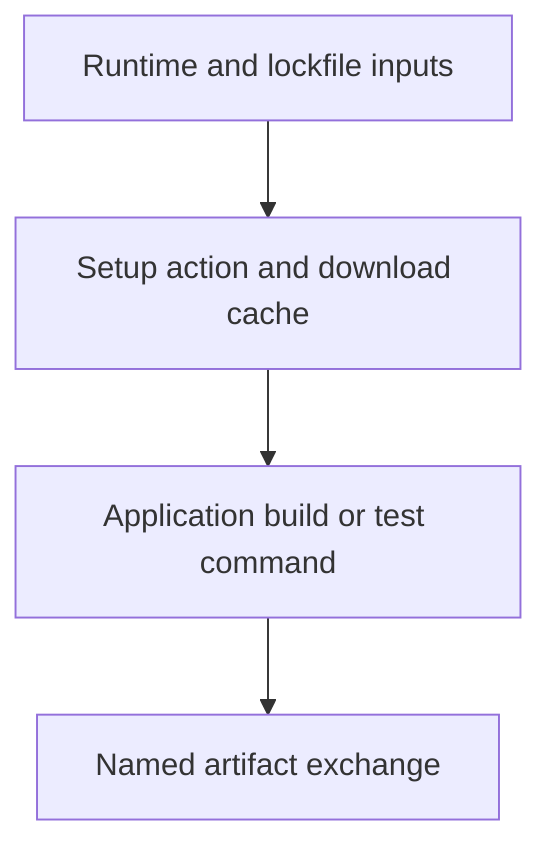

# 0051 · Use setup, cache, and artifact actions instead of bootstrap scripts

!!! note "Teaching brief"
    This page defines the planned lesson. Use its module guide and checked-in examples for context; develop the guided exercise in a teaching session. Written plans and assistant-run checks do not establish learner mastery.

## Prerequisites

- [0050 · Replace git-diff shell logic with dorny/paths-filter](0050-paths-filter-and-selective-jobs.md)
- [Module guide](prebuilt-actions.md)

## What you will learn to do

- Configure tools and download caches through maintained setup actions.
- Exchange named build artifacts without manual archive or upload loops.

## Explain the Actions behavior

1. Setup actions declare runtime and package-manager configuration through inputs.
2. Dependency download caching is a reuse optimization and does not replace installing the project dependencies.
3. Artifact upload and download actions exchange named results between isolated jobs.

Prefer maintained pre-built actions for standard platform operations. Keep project build/test commands explicit and introduce custom code only where the required behavior needs it. Follow the [teaching guide](teaching-guide.md).

## Planned local lab

Develop the exercise under `labs/0051/` or extend the linked examples. Reuse installed tools and explain what each check proves.

1. Read the setup-node and setup-uv steps in the CI recipe and explain the remaining application commands.
2. Change the npm lockfile and predict the cache behavior without removing npm ci.
3. Trace the action-bundle artifact from upload to the separate consumer job.

## Break it and diagnose it

Delete npm ci after adding a download cache and diagnose missing installed dependencies. Restore installation while retaining the cache.

Ask for a prediction before reproducing the failure. Keep permission-dependent and remote-service behavior separate from local static checks.

## Planning diagram



## Retrieval questions

1. What exactly is cached by setup-node with cache: npm?
2. Why are artifacts different from dependency caches?
3. Which commands still perform application work after setup is delegated to actions?

## Evidence and remaining limits

Capture the learner's prediction, modified example, failure diagnosis, repair, and explanation of the appropriate test boundary. Local YAML validation does not execute a remote action or prove GitHub permissions. Hosted exercises and repository writes need a deliberate execution plan.

Use the [primary sources](../references/resources.md) and [dated action catalog](../references/prebuilt-actions.md). Recheck current releases, publisher evidence, and permissions when developing the lesson.

## Start this lesson in a new thread

```text
/teach 0051

Expand docs/lessons/0051-setup-cache-and-artifact-actions.md in place.
Read docs/mission.md, NOTES.md, docs/lessons/teaching-guide.md, the module
guide, and prerequisite Actions pages. Prefer pre-built actions over shell glue.
Teach one concept at a time. Ask for predictions and exercises before revealing
solutions. Keep local checks small, distinguish hosted effects, and record only
actual learner evidence.
```

| Previous | All lessons | Next |
| --- | --- | --- |
| [0050 · Replace git-diff shell logic with dorny/paths-filter](0050-paths-filter-and-selective-jobs.md) | [Curriculum](index.md) | [0052 · Compose Docker build and cloud authentication actions](0052-docker-build-and-cloud-auth-actions.md) |
