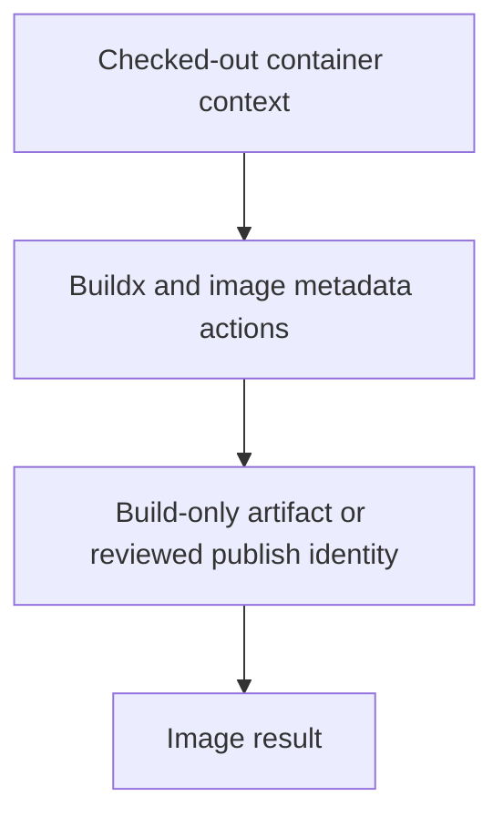

# 0052 · Compose Docker build and cloud authentication actions

!!! note "Teaching brief"
    This page defines the planned lesson. Use its module guide and checked-in examples for context; develop the guided exercise in a teaching session. Written plans and assistant-run checks do not establish learner mastery.

## Prerequisites

- [0051 · Use setup, cache, and artifact actions instead of bootstrap scripts](0051-setup-cache-and-artifact-actions.md)
- [Module guide](prebuilt-actions.md)

## What you will learn to do

- Build and label an image using Docker-maintained actions instead of CLI glue scripts.
- Explain how vendor authentication actions use an explicit identity and permission contract.

## Explain the Actions behavior

1. Buildx setup, metadata generation, registry login, and image builds expose separate action interfaces.
2. A build-only workflow can produce an OCI artifact without registry credentials or pushing an image.
3. Cloud login actions configure an identity; role trust, token permissions, and deployment approval remain explicit.

Prefer maintained pre-built actions for standard platform operations. Keep project build/test commands explicit and introduce custom code only where the required behavior needs it. Follow the [teaching guide](teaching-guide.md).

## Planned local lab

Develop the exercise under `labs/0052/` or extend the linked examples. Reuse installed tools and explain what each check proves.

1. Read examples/prebuilt-actions/container-build.yml and identify the metadata and cache inputs.
2. Inspect the saved Marketplace evidence for Docker, AWS, Azure, and Google Cloud publishers.
3. Design a separate reviewed publish variant with narrowly scoped identity and an intended environment.

## Break it and diagnose it

Enable push without configuring registry authentication. Diagnose the missing identity boundary, then keep the basic recipe build-only until publish credentials are deliberately configured.

Ask for a prediction before reproducing the failure. Keep permission-dependent and remote-service behavior separate from local static checks.

## Planning diagram



## Retrieval questions

1. Which action produces image tags and labels?
2. Why does a successful build not prove registry or cloud authorization?
3. Where would id-token: write and cloud trust policy apply?

## Evidence and remaining limits

Capture the learner's prediction, modified example, failure diagnosis, repair, and explanation of the appropriate test boundary. Local YAML validation does not execute a remote action or prove GitHub permissions. Hosted exercises and repository writes need a deliberate execution plan.

Use the [primary sources](../references/resources.md) and [dated action catalog](../references/prebuilt-actions.md). Recheck current releases, publisher evidence, and permissions when developing the lesson.

## Start this lesson in a new thread

```text
/teach 0052

Expand docs/lessons/0052-docker-build-and-cloud-auth-actions.md in place.
Read docs/mission.md, NOTES.md, docs/lessons/teaching-guide.md, the module
guide, and prerequisite Actions pages. Prefer pre-built actions over shell glue.
Teach one concept at a time. Ask for predictions and exercises before revealing
solutions. Keep local checks small, distinguish hosted effects, and record only
actual learner evidence.
```

| Previous | All lessons | Next |
| --- | --- | --- |
| [0051 · Use setup, cache, and artifact actions instead of bootstrap scripts](0051-setup-cache-and-artifact-actions.md) | [Curriculum](index.md) | [0053 · Automate releases, pull requests, and reports with pre-built actions](0053-release-pr-and-reporting-actions.md) |
