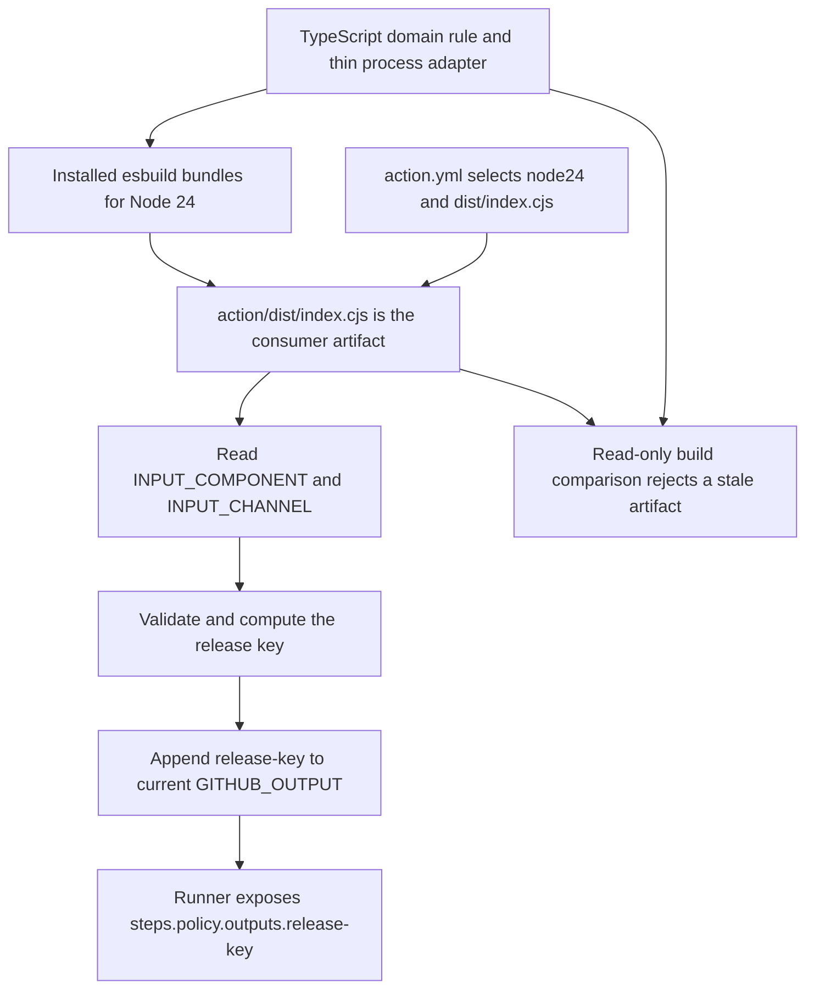

# 0052 · Create a JavaScript or TypeScript action with a tested distribution

!!! note "Authored reference lesson"
    Build a small domain action, then observe a stale distribution and its repair in a temporary copy. All implementation files are isolated under `labs/0052/`. Predictions and exercises remain for the learner; authoring does not establish mastery.

## Prerequisites and goal

Read [0051 · Compose maintained setup](0051-own-composite-action-from-prebuilt-actions.md), [0050 · Metadata contracts](0050-own-action-metadata-and-contracts.md), and [0005 · Output channels](0005-environment-files-and-output-contracts.md). Use the installed Node 24, TypeScript, and esbuild listed in the [local testing guide](../cheatsheet/local-testing.md); do not install another dependency tree.

The goal is to implement the contract proposed in 0049: compute a reusable release key from validated component and channel inputs. This action only computes a label. The caller decides whether to use it for a report, artifact name, or future release. You will test the pure rule, the actual distributed process, and source/distribution agreement. All commands run from the repository root.

## Separate domain behavior from the runner adapter

The **domain rule** is the team-specific behavior that justifies custom code. It does not know about GitHub, environment variables, files, or logs. Here it validates two strings and produces a stable key:

```typescript title="labs/0052/action/src/domain.ts"
export function releaseKey(component: string, channel: string): string {
  if (!/^[a-z][a-z0-9-]{0,31}$/u.test(component) || /[\r\n]/u.test(component)) { // (1)!
    throw new Error('component must match [a-z][a-z0-9-]{0,31}');
  }
  if (channel !== 'preview' && channel !== 'stable') {
    throw new Error('channel must be preview or stable');
  }
  return `${component}-${channel}`;
}
```

1. The expression permits a lowercase ASCII letter followed by zero to 31 lowercase letters, digits, or hyphens. The explicit CR/LF check also rejects a trailing newline, which JavaScript's `$` anchor can otherwise allow. The rule does not trim input: accepting ` Docs ` would change this contract.

`releaseKey('docs', 'preview')` returns `docs-preview`. Empty strings, uppercase labels, traversal-like text, newline-containing values, and arbitrary channels fail. The output's limited alphabet also makes a single-line output record safe. This is a naming policy, not a globally unique identifier or a concurrency lock: two callers can compute the same key.

The **process adapter** in `src/index.ts` translates the Actions interface into that rule:

```typescript title="Adapter core; the complete file also catches failures"
const key = releaseKey(
  process.env.INPUT_COMPONENT ?? 'docs',
  process.env.INPUT_CHANNEL ?? 'preview',
);
const output = process.env.GITHUB_OUTPUT;
if (!output) throw new Error('GITHUB_OUTPUT must be set');
appendFileSync(output, `release-key=${key}\n`, 'utf8');
console.log(`Computed release key: ${key}`);
```

The file imports Node's `appendFileSync` and the domain function. Its `catch` prints the error and sets `process.exitCode = 1`. Validation happens before publication. A missing/unwritable output destination also fails; a success log is emitted only after the write returns. There is no shell command evaluation, token, network request, or release API in this implementation.

The adapter has direct-process fallback values because host tests do not evaluate action metadata. Metadata declares matching defaults for real callers. Explicit empty environment values are not replaced by `??`; they reach validation and fail.



## Define the runtime consumers actually receive

The metadata in `labs/0052/action/action.yml` declares the two input defaults and `release-key` output. Its execution section is:

```yaml title="Metadata runtime excerpt"
runs:
  using: node24
  main: dist/index.cjs # (1)!
```

1. This file path is relative to the action directory. The runner executes the packaged JavaScript; it does not compile `src/index.ts` for the consumer.

TypeScript is an authoring language, not an additional action runtime. `dist` is a conventional directory name; the decisive field is `runs.main`. JavaScript actions can run directly on supported runner operating systems, but actual portability depends on their dependencies and behavior. This example uses Node built-ins only; the host test is still not evidence for an untested Windows runner. See the [JavaScript action tutorial](https://docs.github.com/en/actions/tutorials/create-actions/create-a-javascript-action) for the packaging model.

The official [TypeScript action template](https://github.com/actions/typescript-action) provides fuller maintenance patterns. This introductory lab stays small: no new toolkit dependency is installed. A production action with API requests, multiline outputs, masking, or annotations can benefit from the maintained Actions Toolkit. Choose helpers for those transport responsibilities without confusing them with the custom domain policy.

!!! tip "Prediction"
    You change `releaseKey` to return `v2-docs-preview`, leave the bundle untouched, and invoke the consumer. Which spelling does the caller get? Can `npm ci` in the caller repair your published action package?

??? tip "Worked prediction"
    The caller executes the old distribution and gets `docs-preview`. Dependency installation in the caller's project does not rebuild a separately supplied action. The action publisher must ship the correct runtime artifact.

## Lab: type-check, compare, and test different boundaries

The lab contains already-generated `action/dist/index.cjs`. Begin with a check that does not repair anything:

```bash
node_modules/.bin/tsc --ignoreConfig --noEmit --strict --target ES2022 \
  --module NodeNext --moduleResolution NodeNext --types node \
  labs/0052/action/src/domain.ts labs/0052/action/src/index.ts
node labs/0052/build.cjs --check
node --test labs/0052/test.cjs
```

Expected: the type checker exits zero without diagnostics, the comparison prints `PASS: distribution matches source`, and Node reports **7 passed, 0 failed**. Test timings and formatting vary by Node version. The installed TypeScript 7 requires `--ignoreConfig` when checking explicit file arguments beside the repository's `tsconfig.json`; it keeps this lab's selected compiler options independent of the shared example configuration.

| Check | Actual observation | Remaining boundary |
| --- | --- | --- |
| TypeScript `--noEmit` | The source satisfies these types/compiler options | It does not validate arbitrary runtime strings |
| Pure-rule tests | Valid key spelling and rejection rules | Environment transport and filesystem writes |
| Distribution process tests | Actual `dist` input transport, exit code, stdout/stderr, exact output records | Runner's metadata and output-expression execution |
| Build comparison | Rebuilt artifact bytes match the supplied distribution | Hosted runtime compatibility and remote action resolution |

The pure tests bundle only the domain module into a temporary file, import it without invoking the adapter, and remove it afterward. The process tests spawn the actual `dist/index.cjs`, seed a temporary output file with an earlier record, and assert append behavior. They also cover explicit inputs, invalid strings, a missing output variable, and an output path that points at a directory. Invalid input must leave the earlier record unchanged and emit no success log.

`build.cjs` uses the already installed [esbuild API](https://esbuild.github.io/api/) with `bundle: true`, `platform: node`, `target: node24`, and CommonJS output. It sets an explicit working directory so source-path comments remain stable for the comparison. Node built-ins remain runtime imports; there are no third-party runtime dependencies to resolve outside the bundle. Bundling transforms TypeScript but does not replace type-checking.

### Make the stale-artifact failure observable

```bash
node labs/0052/stale-demo.cjs
```

Expected:

```text
FAIL: stale distribution; rebuild with --write and review the diff
Before rebuild: release-key=docs-preview
After rebuild: release-key=v2-docs-preview
PASS: stale failure and repair observed in a temporary copy
```

The demonstration first verifies the copied distribution, changes the copied domain source to prefix `v2-`, and checks again. The comparison child exits **1**. It then invokes the unchanged distribution to observe the old result, explicitly rebuilds the temporary copy, checks agreement, and observes the new result. The demonstration as a whole exits zero only if the failure and repair both match expectations.

??? tip "Diagnosis and repair"
    Identify `runs.main`, inspect the artifact it names, and compare it with a fresh build. The consumer is correctly running the artifact you supplied. For an intentional real source edit, run `node labs/0052/build.cjs --write`, review the generated diff, then repeat type-checking, the read-only comparison, and behavior tests. A changed naming rule may require a major version even when every local check passes. Do not silently rebuild inside the comparison check; that would hide the release mistake.

The `--write` command updates only this owned lab's distribution. `task actions:build` targets the shared example and is not the command for this isolated action.

## Connect the complete consumer

`labs/0052/consumer.yml` checks out this repository, then invokes:

```yaml title="Inactive consumer excerpt"
- id: policy
  uses: ./labs/0052/action
  with:
    component: docs
    channel: preview
- name: Assert the public output
  env:
    RELEASE_KEY: ${{ steps.policy.outputs.release-key }}
  shell: bash
  run: test "$RELEASE_KEY" = docs-preview
```

Inputs are passed as data. The assertion receives the output through an environment value rather than inserting arbitrary caller text into shell source. The action computes the label; the consumer demonstrates its public mapping. An empty mapping can be a wiring error even when the process tests pass.

```bash
.tools/bin/actionlint labs/0052/consumer.yml
```

Expected: exit zero with no diagnostics. A future selected execution must still check the runner's input injection and `steps.policy.outputs.release-key` result. The recipe has a manual trigger, read-only checkout permission, a five-minute timeout, and no release operation. Saving it under `labs/` does not activate it on GitHub.

## Transfer exercise and retrieval

A team wants a `nightly` channel. Write the compatibility decision and changed cases before implementing anything. Then, in the owned lab, add it to the accepted channel rule, update its metadata description, rebuild deliberately, and check the new process output. Preserve rejection of unknown channels and empty strings.

1. Which file does the consumer execute?
2. Why are pure tests, process tests, and distribution checks different evidence?
3. Why can a TypeScript type still need runtime validation?
4. Does a stable output string prove a release operation occurred?

??? tip "Worked transfer and retrieval"
    Adding `nightly` is an accepted-input expansion if all existing behavior remains compatible. Add pure and process cases expecting `docs-nightly`, then rebuild and compare. The consumer executes `dist/index.cjs` because metadata names it. A pure test observes policy; a process test observes transport/I/O; the comparison observes agreement between source and shipped bytes. Environment values remain uncontrolled runtime strings despite the function's TypeScript parameter type. The output is a computed label and does not publish anything.

## Evidence and next lesson

The lab gives local type, policy, process, distribution, and static consumer evidence. GitHub runner download/runtime behavior, the intended OS matrix, and public output mapping remain integration checks. No hosted run has been performed by this authoring task. Sources were checked on **2026-10-30**, including the [Node 24 test-runner documentation](https://nodejs.org/docs/latest-v24.x/api/test.html); exact check results are in `labs/module-9-handoff.md`.

Continue to [0053](0053-own-docker-action-and-image-contract.md) for a different runtime/package boundary. Revisit [Module 4](0019-javascript-action-runtime-and-toolkit.md) for toolkit APIs, lifecycle hooks, cross-platform behavior, and dependency maintenance.

| Previous Lesson | All Lessons | Next Lesson |
| --- | --- | --- |
| [0051 · Create a composite action by composing pre-built actions](0051-own-composite-action-from-prebuilt-actions.md) | [Curriculum](index.md) | [0053 · Create a Docker action with tested arguments, mounts, and outputs](0053-own-docker-action-and-image-contract.md) |
