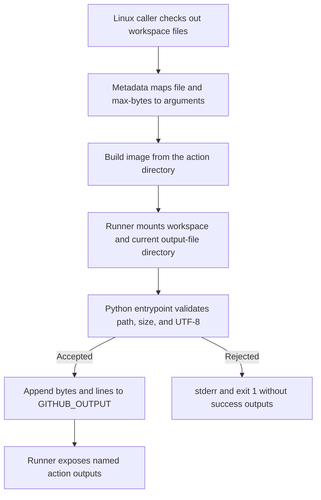

# 0053 · Create a Docker action with tested arguments, mounts, and outputs

!!! note "Authored reference lesson"
    This introductory Docker action inspects a bounded workspace file. Its host tests are runnable without a daemon; its separate image test requires one. Developed material and assistant-run tests do not establish learner mastery.

## Prerequisites and goal

Read [0052 · Node packaging](0052-own-node-action-and-distribution.md), [0050 · Action contracts](0050-own-action-metadata-and-contracts.md), and [0010 · Engines and architecture](0010-container-engines-images-and-architecture.md). Recall [0005 · Output files](0005-environment-files-and-output-contracts.md): the runner supplies a path, not a magic stdout parser. See the [local testing guide](../cheatsheet/local-testing.md#run-the-docker-boundary) if the existing engine is unavailable.

Your goal is to trace metadata arguments into a Python process in a Linux image, inspect one caller file, and publish byte/line counts through the supplied output path. You will distinguish host program evidence from image, mount, and GitHub evidence. Commands run from the repository root. Do not provision a VM or install tools to make this introductory exercise appear green.

## Choose Docker for a runtime requirement

The earlier Node policy needs only Node built-ins, so putting it into an image would add little value. A real file scanner might depend on a particular Linux toolchain or runtime that needs packaging. This lab uses Python's standard library to keep that packaging boundary visible without introducing unrelated tools; the operation itself could run on a suitable host.

A **Docker container action** asks a Linux runner with Docker support to build or obtain an image and start its entrypoint. The program has a container filesystem. Caller files and runner communication paths must be accessible through mounts. Docker actions are not a way to run a Linux container step directly on a GitHub-hosted Windows or macOS runner; use a Linux job. Your laptop can still launch Linux containers through its existing engine/VM. See GitHub's [container action tutorial](https://docs.github.com/en/actions/tutorials/use-containerized-services/create-a-docker-container-action).

The package is isolated under `labs/0053/action/`. It extends the existing Docker greeting adapter's structure into a read-only file-inspection operation:

| Contract | Accepted behavior |
| --- | --- |
| `file` input | Required nonempty relative path to an existing regular UTF-8 file inside `GITHUB_WORKSPACE` |
| `max-bytes` input | Decimal integer from 1 through 1048576; metadata default `'1024'` |
| Success outputs | `bytes` and `lines`, decimal strings |
| Line definition | Python text `splitlines()` count; a trailing newline does not add an extra empty line |
| Invalid data or failed I/O | Exit 1, stderr diagnosis, no success records from that run |
| Side effects | Read file and append output records; no upload, token, or network operation |

The process reads at most the chosen limit plus one byte, so an oversized file is rejected without reading its entire contents. It decodes UTF-8 strictly before publishing. It resolves the input path and rejects a target outside the workspace, including the tested escaping symlink. These guards define this lab's accepted inputs; they are not a sandbox against concurrent malicious filesystem changes.

## Read metadata, image, and process as three interfaces

The metadata declares both input descriptions and output names. Its execution section is:

```yaml title="labs/0053/action/action.yml — execution excerpt"
runs:
  using: docker
  image: Dockerfile # (1)!
  args:
    - ${{ inputs.file }} # (2)!
    - ${{ inputs.max-bytes }}
```

1. `Dockerfile` resolves relative to the action's metadata directory. The build context is the action package, not the whole caller checkout.
2. Each list item becomes a process argument. A path containing spaces remains one argument; the Python program receives the filename and limit as `sys.argv[1]` and `sys.argv[2]`.

Input declarations alone do not populate Python's argument list. The explicit metadata mapping is part of the contract. Our direct test supplies these same two arguments; it does not evaluate `${{ inputs.file }}` itself.

```dockerfile title="labs/0053/action/Dockerfile"
FROM python:3.14-alpine
ENV PYTHONDONTWRITEBYTECODE=1
COPY entrypoint.py /entrypoint.py
ENTRYPOINT ["python3", "/entrypoint.py"]
```

`COPY` packages the program in the image. The exec-form entrypoint starts Python without adding shell interpretation; caller input is data, not shell source. Code lives at `/entrypoint.py`, outside the caller's workspace mount. GitHub supplies the workspace at `/github/workspace`; placing bundled code under that mount would risk hiding it. GitHub's [Dockerfile support reference](https://docs.github.com/en/actions/reference/workflows-and-actions/dockerfile-support) explains entrypoint and workspace interactions.

This teaching image reuses the existing version-tagged Python base. The tag is mutable, so it is not a reproducibility claim or a reviewed digest. A production package must review its base, updates, vulnerabilities, and supported architecture. [Module 3](0013-docker-action-metadata-and-lifecycle.md) develops those decisions in depth.



!!! tip "Prediction"
    The file is visible at `/github/workspace`, but the program writes its results to `/tmp/output`. It logs the expected counts and exits zero. Does the caller receive either named output?

??? tip "Worked prediction"
    The caller receives values only when the program writes the current runner-provided output file. A private container file and stdout are different channels. Even a zero exit cannot compensate for writing the wrong path.

## The actual output protocol

After input validation and inspection, the adapter uses:

```python title="Entrypoint output excerpt"
output_path = os.environ.get("GITHUB_OUTPUT")
if not output_path:
    raise ValueError("GITHUB_OUTPUT must be set")
with Path(output_path).open("a", encoding="utf-8") as output:
    output.write(f"bytes={size}\nlines={lines}\n")
```

Use this exact environment-provided destination. In a real container action the runner arranges communication mounts; in a manual `docker run` you must mount a directory and supply the corresponding **container** path yourself. Passing the host's temporary path without a matching mount does not make it visible in the container.

`GITHUB_WORKSPACE` identifies the caller files; `GITHUB_OUTPUT` identifies a step communication file. They serve different purposes and need not be in the same mounted directory. Files written into the workspace can be read by later steps in the same job; neither workspace writes nor `GITHUB_OUTPUT` automatically transfer a file to another hosted job.

## Lab: test the real entrypoint before the image

The fixture `labs/0053/fixtures/release notes.txt` contains exactly:

```text
alpha
beta
```

With its trailing newline it has **11 bytes and 2 lines**. Before running, predict what a maximum of 10 bytes should do:

```bash
uv run python labs/0053/contract.py
```

Expected: **11 `PASS:` case lines**, followed by:

```text
PASS: 11 host process cases; no GitHub runner used
```

The cases cover the spaced filename, an exact 11-byte limit, an oversized file, empty input, escaping path, invalid limit, missing file, missing output variable, output directory instead of file, invalid UTF-8, and an escaping symlink. Every case uses a real Python subprocess, temporary caller workspace, and seeded output file. Invalid cases must return nonzero, write stderr rather than success logs, and preserve the earlier output record. The harness removes the temporary files afterward.

These are **host** tests. They cannot establish that the Dockerfile builds, Python exists in the selected image, the image architecture matches the engine, or mounts are writable. Passing them is a reason to proceed to the next boundary, not to skip it.

### Reproduce a guessed output path

```bash
uv run python labs/0053/contract.py --wrong-output
```

Expected: the harness exits **1** on the first valid case. Its diagnostic begins `FAIL: valid spaced path; exit=0; runner output='existing=value\n'`. The temporary mutated program wrote a separate `guessed-output.txt`, leaving the expected runner file unchanged.

??? tip "Diagnosis and repair"
    Inspect process status and actual runner output separately. The guessed path is a protocol failure even though computation succeeded. Restore `os.environ.get("GITHUB_OUTPUT")`, ensure the destination is mounted for a container run, and rerun the host contract without `--wrong-output`. This experiment changes a temporary entrypoint only; the lab's working implementation is preserved.

## Add the image and mount evidence only with an available engine

First query the existing engine:

```bash
docker info
```

If it fails, record the exact socket/engine error and stop this boundary. Keep the image and `act` checks deferred. Host success must not be relabeled as container success.

With a working existing engine, the intended commands are:

```bash
docker build --tag actions-learn-module9-inspect:local labs/0053/action
uv run python labs/0053/contract.py --container actions-learn-module9-inspect:local
```

Expected only after actual execution: the image builds, then the same **11 container cases** pass. The harness starts the built image with `--network none`, a read-only caller workspace mount, a separate writable `/runner-io` mount, and `GITHUB_OUTPUT=/runner-io/step output.txt`. The build can still require downloading a base image. A manual image test is not the GitHub runner's own mount implementation.

The harness uses the engine's default image architecture. If you choose another target architecture, explicitly align the build, runtime, and runner plan and record it. Do not guess that an Apple Silicon host proves Linux AMD64 compatibility.

## Inspect the complete workflow boundary

`labs/0053/consumer.yml` is an inactive Linux recipe. After checkout it calls:

```yaml title="Consumer excerpt"
- id: inspect
  uses: ./labs/0053/action
  with:
    file: labs/0053/fixtures/release notes.txt
    max-bytes: '1024'
```

The action's input file is relative to the caller workspace; the Dockerfile is relative to the action package. The next step asserts `steps.inspect.outputs.bytes` is `11` and `lines` is `2` through environment values. A static check is:

```bash
.tools/bin/actionlint labs/0053/consumer.yml
```

Expected: exit zero with no diagnostics. It cannot build the image or prove the mounted runtime interface. A future reviewed GitHub run would execute the whole metadata-to-container-to-output chain; no hosted run is part of this authoring task.

## Transfer and retrieval

Adapt the fixture to contain `A\n` followed by one non-ASCII character and a newline. Compute expected bytes and lines before testing. Then explain why a byte limit and a character limit are different interfaces. Keep the size failure and wrong-output cases.

1. Which requirement makes Docker useful in a real scanner?
2. Who maps action inputs to program arguments?
3. Which path refers to caller files, and which to runner communication?
4. Which evidence is still missing after only the host test passes?

??? tip "Worked transfer and retrieval"
    For `A\nλ\n`, UTF-8 uses 5 bytes and 2 lines: the lambda occupies two bytes. The fixed byte limit bounds data read, not the count of visible characters. A packaged Linux toolchain can justify Docker. Metadata maps inputs into this program's arguments. `GITHUB_WORKSPACE` contains caller files; `GITHUB_OUTPUT` names the current step's output file. Host tests leave the build, image dependencies, architecture, container filesystem/mounts, runner wiring, and GitHub policy unverified.

## Evidence and next lesson

Record which of host, image, static consumer, local workflow, and GitHub checks actually ran. An unavailable engine is an explicit deferred boundary, not learner failure. Sources were checked on **2026-10-30**; see `labs/module-9-handoff.md` for exact commands and results. Continue to [0054](0054-own-action-release-and-marketplace.md) to assemble a local release candidate before the production capstone.

| Previous Lesson | All Lessons | Next Lesson |
| --- | --- | --- |
| [0052 · Create a JavaScript or TypeScript action with a tested distribution](0052-own-node-action-and-distribution.md) | [Curriculum](index.md) | [0054 · Document, version, and publish your action for real consumers](0054-own-action-release-and-marketplace.md) |
