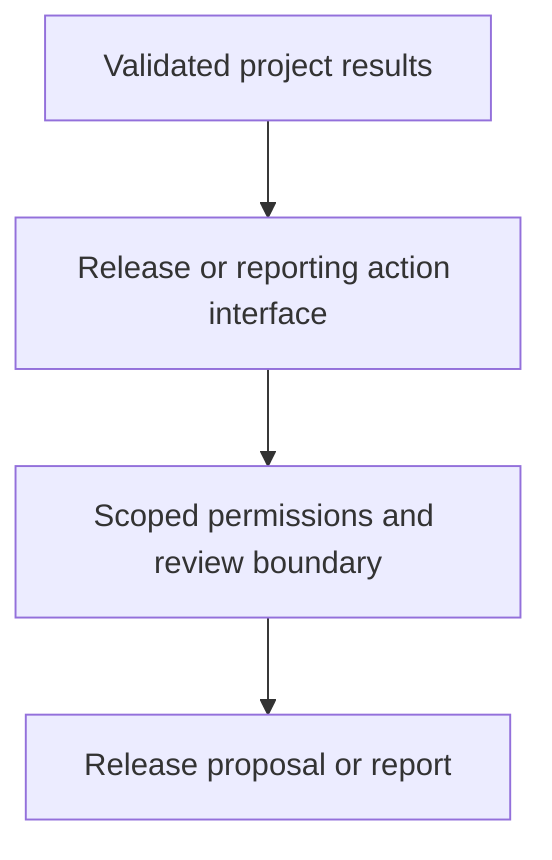

# 0053 · Automate releases, pull requests, and reports with pre-built actions

!!! note "Teaching brief"
    This page defines the planned lesson. Use its module guide and checked-in examples for context; develop the guided exercise in a teaching session. Written plans and assistant-run checks do not establish learner mastery.

## Prerequisites

- [0052 · Compose Docker build and cloud authentication actions](0052-docker-build-and-cloud-auth-actions.md)
- [Module guide](prebuilt-actions.md)

## What you will learn to do

- Replace release and generated-change API scripts with explicit maintained action interfaces.
- Identify the write permissions and external effects of release, PR, and reporting recipes.

## Explain the Actions behavior

1. Release Please proposes version and changelog changes through its release workflow.
2. Community actions such as peter-evans/create-pull-request and dorny/test-reporter need their own publisher and permission decisions.
3. Reporting, repository mutation, and external service upload are different effects and should be enabled deliberately.

Prefer maintained pre-built actions for standard platform operations. Keep project build/test commands explicit and introduce custom code only where the required behavior needs it. Follow the [teaching guide](teaching-guide.md).

## Planned local lab

Develop the exercise under `labs/0053/` or extend the linked examples. Reuse installed tools and explain what each check proves.

1. Inspect examples/prebuilt-actions/release-please.yml without activating it.
2. Compare verified Google release automation with the community release and PR entries in the catalog.
3. Write the required permission and review boundary for a release PR, test check, and Codecov upload.

## Break it and diagnose it

Copy write permissions into an untrusted pull-request workflow. Diagnose why choosing an action does not remove the event trust boundary and separate the privileged operation.

Ask for a prediction before reproducing the failure. Keep permission-dependent and remote-service behavior separate from local static checks.

## Planning diagram



## Retrieval questions

1. What does Release Please change after its workflow is activated?
2. Which selected actions have an observed Marketplace creator badge?
3. Why must the template remain inactive until its write effects are intended?

## Evidence and remaining limits

Capture the learner's prediction, modified example, failure diagnosis, repair, and explanation of the appropriate test boundary. Local YAML validation does not execute a remote action or prove GitHub permissions. Hosted exercises and repository writes need a deliberate execution plan.

Use the [primary sources](../references/resources.md) and [dated action catalog](../references/prebuilt-actions.md). Recheck current releases, publisher evidence, and permissions when developing the lesson.

## Start this lesson in a new thread

```text
/teach 0053

Expand docs/lessons/0053-release-pr-and-reporting-actions.md in place.
Read docs/mission.md, NOTES.md, docs/lessons/teaching-guide.md, the module
guide, and prerequisite Actions pages. Prefer pre-built actions over shell glue.
Teach one concept at a time. Ask for predictions and exercises before revealing
solutions. Keep local checks small, distinguish hosted effects, and record only
actual learner evidence.
```

| Previous | All lessons | Next |
| --- | --- | --- |
| [0052 · Compose Docker build and cloud authentication actions](0052-docker-build-and-cloud-auth-actions.md) | [Curriculum](index.md) | [0054 · Compose an action-based pipeline and maintain its dependencies](0054-compose-maintained-actions-and-manage-updates.md) |
