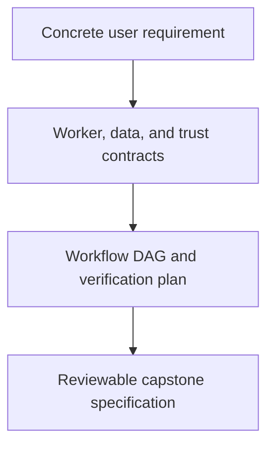

# 0055 · Specify the repository-health orchestrator and acceptance criteria

!!! note "Placeholder for a future teaching thread"
    This page is a teaching brief. Expand it into a full interactive lesson in its own thread. The planned exercises and outcomes have not been completed or demonstrated.

**Level:** Professional practice.

## Prerequisites

- [0054 · Document, version, and publish your action for real consumers](0054-own-action-release-and-marketplace.md)
- [0048 · Hosted trials, model variability, usage budgets, and diagnostics](0048-agentic-hosted-trials-budgets-and-diagnostics.md)
- [0030 · Compose setup/build/test steps and reusable job workflows](0030-compose-step-and-job-orchestration.md)
- [0035 · Commit pins, semantic releases, major tags, and distribution integrity](0035-sha-pins-semantic-releases-and-provenance.md)

## What you will learn to do

- Write a concrete capstone specification and workflow DAG.
- Map each requirement to local evidence or a hosted integration check.

## Explain the Actions behavior

Start from the prerequisite workflow or action behavior and introduce these concepts with focused examples:

1. A professional orchestrator coordinates workers through explicit inputs, outputs, dependencies, and trust boundaries.
2. Acceptance criteria define observable behavior for success and failure.
3. A design should state constraints, verification gaps, and operational ownership before implementation expands.

Explain the relevant workflow YAML, expressions, and action code in context. Follow the [shared teaching guide](teaching-guide.md) for pacing, expected output, and progression toward independent design.

## Planned local lab

Create an isolated exercise under `labs/0055/` when the lesson is developed. Explain setup and expected output before each command; reuse installed tools rather than reinstalling them on every step.

1. Specify a repository-health report with deterministic checks, optional agentic proposals, and a reviewed release path.
2. Draw job dependencies, runner choices, artifact exchange, credentials, deadlines, and concurrency policy.
3. Define negative cases, release gates, usage limits, rollback expectations, and the evidence required for acceptance.

## Break it and diagnose it

Start with one monolithic privileged workflow that mixes testing, reporting, and publishing. Find hidden contracts and split responsibilities by evidence and authority.

Ask for a prediction first. Capture the smallest reproducer, the actual result, and the corrected behavior. State which remaining claim requires a real GitHub or external-service check.

## Planning diagram



When expanding this lesson, refine the diagram to show the actual processes, branches, data exchange, and trust boundaries being taught.

## Retrieval questions

1. What decision belongs to the orchestrator rather than a worker?
2. Which failures must block a release?
3. Who can explain and operate the system after its original author leaves?

## Evidence to capture in the teaching thread

- A working learner-produced example and an explanation of why it works.
- A reproduced failure, a reasoned repair, and the smallest check that verifies it.
- A short account of remaining limits, unresolved questions, and readiness for the next lesson.

Use [primary references](../references/resources.md) to verify current syntax, runtime support, and tool behavior. Add learning records only for real statements or demonstrated understanding; a placeholder or generated page does not establish mastery.

## Start this lesson in a new thread

```text
/teach 0055

Expand docs/lessons/0055-capstone-specification-and-orchestrator-design.md in place using docs/lessons/teaching-guide.md.
Read docs/mission.md, NOTES.md, and the prerequisite lesson pages first.
Begin with a short check of the Actions prerequisites. Explain relevant YAML,
expressions, and action contracts, one concept at a time. Let me predict and
try each exercise before revealing its answer. Keep feedback local where possible.
Finish with retrieval questions and a truthful handoff for the next thread.
```

| Previous Lesson | All Lessons | Next Lesson |
| --- | --- | --- |
| [0054 · Document, version, and publish your action for real consumers](0054-own-action-release-and-marketplace.md) | [Curriculum](index.md) | [0056 · Implement deterministic checks in Docker and TypeScript](0056-capstone-deterministic-docker-and-typescript-workers.md) |
