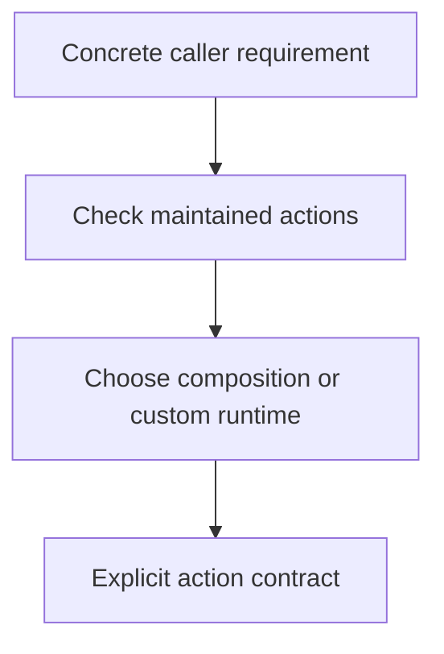

# 0055 · Decide when to reuse, compose, or create your own action

!!! note "Teaching brief"
    This page defines the planned lesson. Use its module guide and checked-in examples for context; develop the guided exercise in a teaching session. Written plans and assistant-run checks do not establish learner mastery.

## Prerequisites

- [0012 · Define the local/hosted coverage boundary and usage budget](0012-local-hosted-coverage-and-usage-budget.md)
- [Module guide](create-your-own-action.md)

## What you will learn to do

- Choose a pre-built action, composite action, Node action, Docker action, or reusable workflow for a concrete need.
- Define the smallest reusable contract before implementing custom behavior.

## Explain the Actions behavior

1. Search the maintained catalog before creating an action for a standard platform task.
2. A composite action packages a repeated step sequence; a reusable workflow owns job orchestration.
3. Choose Node or Docker when the domain behavior or runtime requirements justify custom implementation.

Prefer maintained pre-built actions for standard platform operations. Keep project build/test commands explicit and introduce custom code only where the required behavior needs it. Follow the [teaching guide](teaching-guide.md).

## Planned local lab

Develop the exercise under `labs/0055/` or extend the linked examples. Reuse installed tools and explain what each check proves.

1. Compare the new project-setup composite with the four greeting implementations.
2. Write the caller inputs, outputs, permissions, and platform requirements for a proposed team action.
3. Explain why an existing action does or does not satisfy that contract.

## Break it and diagnose it

Build a custom installer for a task already solved by a maintained setup action. Reassess the maintenance burden and compose the existing action instead.

Ask for a prediction before reproducing the failure. Keep permission-dependent and remote-service behavior separate from local static checks.

## Planning diagram



## Retrieval questions

1. What requirement justifies custom implementation?
2. When does the reusable boundary need to own jobs rather than steps?
3. Which caller-visible behavior must be stable across implementations?

## Evidence and remaining limits

Capture the learner's prediction, modified example, failure diagnosis, repair, and explanation of the appropriate test boundary. Local YAML validation does not execute a remote action or prove GitHub permissions. Hosted exercises and repository writes need a deliberate execution plan.

Use the [primary sources](../references/resources.md) and [dated action catalog](../references/prebuilt-actions.md). Recheck current releases, publisher evidence, and permissions when developing the lesson.

## Start this lesson in a new thread

```text
/teach 0055

Expand docs/lessons/0055-reuse-compose-or-create-an-action.md in place.
Read docs/mission.md, NOTES.md, docs/lessons/teaching-guide.md, the module
guide, and prerequisite Actions pages. Prefer pre-built actions over shell glue.
Teach one concept at a time. Ask for predictions and exercises before revealing
solutions. Keep local checks small, distinguish hosted effects, and record only
actual learner evidence.
```

| Previous | All lessons | Next |
| --- | --- | --- |
| [0012 · Define the local/hosted coverage boundary and usage budget](0012-local-hosted-coverage-and-usage-budget.md) | [Curriculum](index.md) | [0056 · Design action.yml inputs, outputs, runtimes, and failure contracts](0056-own-action-metadata-and-contracts.md) |
