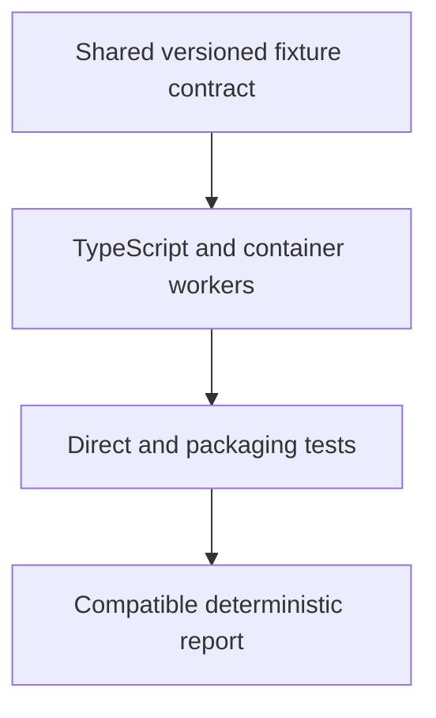

# 0056 · Implement deterministic checks in Docker and TypeScript

!!! note "Placeholder for a future teaching thread"
    This page is a teaching brief. Expand it into a full interactive lesson in its own thread. The planned exercises and outcomes have not been completed or demonstrated.

**Level:** Professional practice.

## Explain the Actions behavior

Use a small workflow or action to explain these concepts:

1. Different packaging choices can implement the same domain contract.
2. A deterministic worker should make inputs, errors, and outputs testable without its orchestrator.
3. Packaging evidence adds to application tests and must not silently change the public report.

Explain the relevant workflow YAML, expressions, and action code in context. Follow the [shared teaching guide](teaching-guide.md) for pacing, expected output, and progression toward independent design.

## Planned local lab

Create an isolated exercise under `labs/0056/` when the lesson is developed. Explain setup and expected output before each command; reuse installed tools rather than reinstalling them on every step.

1. Define a small repository-inspection fixture format and expected report schema.
2. Implement one bounded check in TypeScript and a Docker-packaged variation with the same behavior.
3. Run direct tests first, then bundle and container checks, including invalid input and failed file access.

## Break it and diagnose it

Let the two workers disagree on invalid-input handling or report fields. Use shared contract fixtures to locate and repair the inconsistency.

Ask for a prediction first. Capture the smallest reproducer, the actual result, and the corrected behavior. State which remaining claim requires a real GitHub or external-service check.

## Planning diagram



When expanding this lesson, refine the diagram to show the actual processes, branches, data exchange, and trust boundaries being taught.

## Retrieval questions

1. Which behavior should remain identical across the two packages?
2. Which test catches packaging without retesting all application logic remotely?
3. What makes a worker result safe for a downstream gate to consume?

## Evidence to capture in the teaching thread

- A working learner-produced example and an explanation of why it works.
- A reproduced failure, a reasoned repair, and the smallest check that verifies it.
- A short account of remaining limits, unresolved questions, and readiness for the next lesson.

Use [primary references](../references/resources.md) to verify current syntax, runtime support, and tool behavior. Add learning records only for real statements or demonstrated understanding; a placeholder or generated page does not establish mastery.

## Start this lesson in a new thread

```text
/teach 0056

Expand docs/lessons/0056-capstone-deterministic-docker-and-typescript-workers.md in place using docs/lessons/teaching-guide.md.
Read docs/mission.md, NOTES.md, and the prerequisite lesson pages first.
Begin with a short check of the Actions prerequisites. Explain relevant YAML,
expressions, and action contracts, one concept at a time. Let me predict and
try each exercise before revealing its answer. Keep feedback local where possible.
Finish with retrieval questions and a truthful handoff for the next thread.
```

| Previous Lesson | All Lessons | Next Lesson |
| --- | --- | --- |
| [0055 · Specify the repository-health orchestrator and acceptance criteria](0055-capstone-specification-and-orchestrator-design.md) | [Curriculum](index.md) | [0057 · Compose shared setup and reusable workflow orchestration](0057-capstone-reusable-workflow-fanout-and-fanin.md) |
