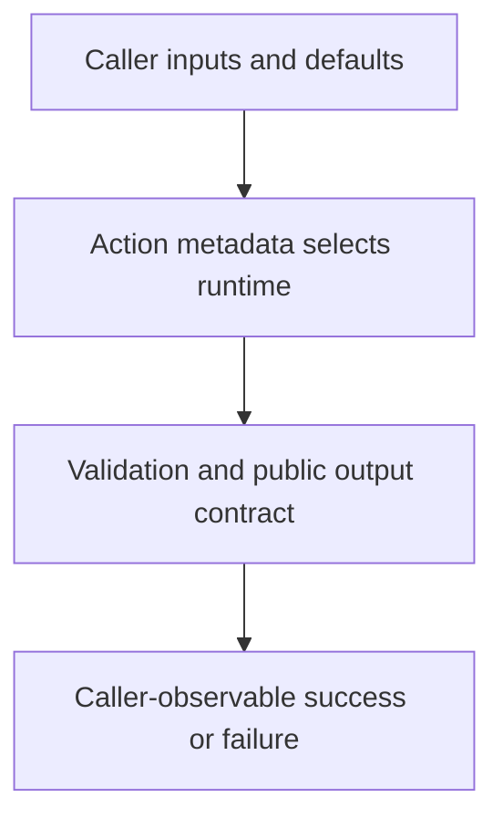

# 0056 · Design action.yml inputs, outputs, runtimes, and failure contracts

!!! note "Teaching brief"
    This page defines the planned lesson. Use its module guide and checked-in examples for context; develop the guided exercise in a teaching session. Written plans and assistant-run checks do not establish learner mastery.

## Prerequisites

- [0055 · Decide when to reuse, compose, or create your own action](0055-reuse-compose-or-create-an-action.md)
- [Module guide](create-your-own-action.md)

## What you will learn to do

- Write metadata that documents defaults, required inputs, outputs, and runtime behavior.
- Explain which validations metadata expresses and which the action must implement.

## Explain the Actions behavior

1. action.yml is the consumer-facing interface for a reusable action.
2. Declared defaults and required flags do not replace runtime validation of the actual input contract.
3. Output values and failure policy must be observable by callers and testable at the correct boundary.

Prefer maintained pre-built actions for standard platform operations. Keep project build/test commands explicit and introduce custom code only where the required behavior needs it. Follow the [teaching guide](teaching-guide.md).

## Planned local lab

Develop the exercise under `labs/0056/` or extend the linked examples. Reuse installed tools and explain what each check proves.

1. Compare the metadata in project-setup-action and javascript-action.
2. Add a proposed input and predict its default and explicitly empty behavior.
3. Design valid, invalid, missing-output, and failed-execution cases before changing code.

## Break it and diagnose it

Declare a required input but accept an invalid empty value at runtime. Diagnose the incomplete validation contract.

Ask for a prediction before reproducing the failure. Keep permission-dependent and remote-service behavior separate from local static checks.

## Planning diagram



## Retrieval questions

1. Which runtime does runs.using select?
2. Where does a composite action map its public output?
3. What does the caller observe when validation fails?

## Evidence and remaining limits

Capture the learner's prediction, modified example, failure diagnosis, repair, and explanation of the appropriate test boundary. Local YAML validation does not execute a remote action or prove GitHub permissions. Hosted exercises and repository writes need a deliberate execution plan.

Use the [primary sources](../references/resources.md) and [dated action catalog](../references/prebuilt-actions.md). Recheck current releases, publisher evidence, and permissions when developing the lesson.

## Start this lesson in a new thread

```text
/teach 0056

Expand docs/lessons/0056-own-action-metadata-and-contracts.md in place.
Read docs/mission.md, NOTES.md, docs/lessons/teaching-guide.md, the module
guide, and prerequisite Actions pages. Prefer pre-built actions over shell glue.
Teach one concept at a time. Ask for predictions and exercises before revealing
solutions. Keep local checks small, distinguish hosted effects, and record only
actual learner evidence.
```

| Previous | All lessons | Next |
| --- | --- | --- |
| [0055 · Decide when to reuse, compose, or create your own action](0055-reuse-compose-or-create-an-action.md) | [Curriculum](index.md) | [0057 · Create a composite action by composing pre-built actions](0057-own-composite-action-from-prebuilt-actions.md) |
