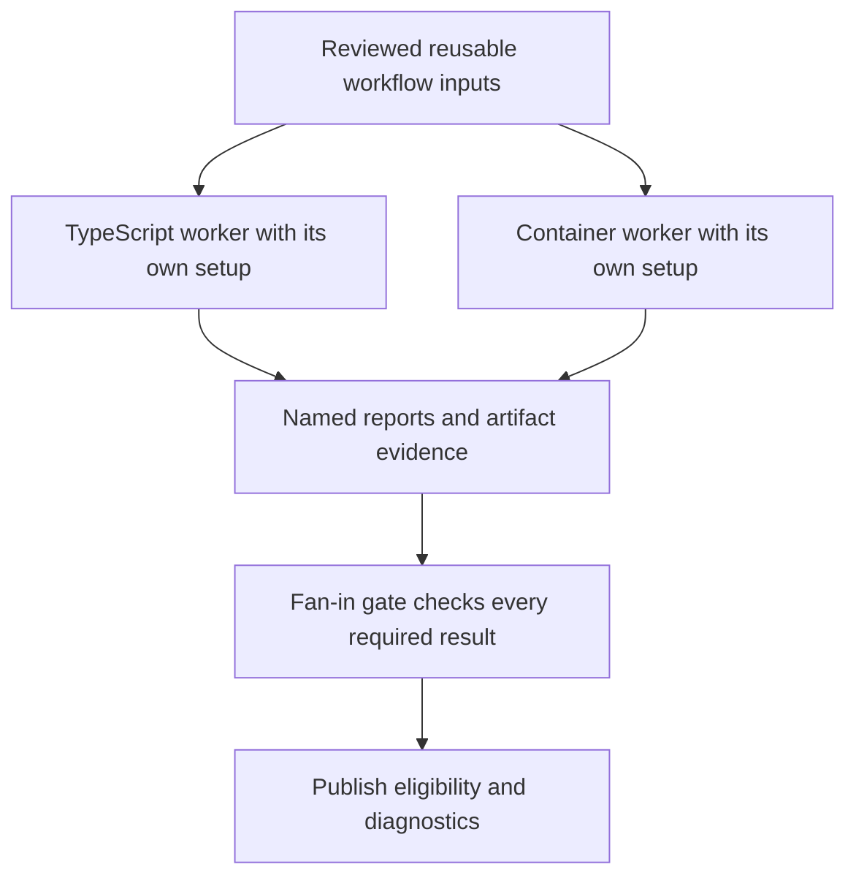

# 0057 · Compose shared setup and reusable workflow orchestration

!!! note "Placeholder for a future teaching thread"
    This page is a teaching brief. Expand it into a full interactive lesson in its own thread. The planned exercises and outcomes have not been completed or demonstrated.

**Level:** Professional practice.

## Prerequisites

- [0056 · Implement deterministic checks in Docker and TypeScript](0056-capstone-deterministic-docker-and-typescript-workers.md)
- [0006 · Matrices, job dependencies, cancellation, and failure propagation](0006-matrices-dependencies-and-cancellation.md)
- [0029 · Reusable workflows, typed inputs, explicit secrets, and permissions](0029-reusable-workflows-and-permission-interfaces.md)
- [0030 · Compose setup/build/test steps and reusable job workflows](0030-compose-step-and-job-orchestration.md)

## What you will learn to do

- Build a reusable multi-job DAG with predictable joins and release eligibility.
- Demonstrate how one failed or skipped worker affects the report and gate.

## Explain the Actions behavior

Start from the prerequisite workflow or action behavior and introduce these concepts with focused examples:

1. Composite setup reuse does not replace the isolation of separate jobs.
2. Fan-out workers and fan-in gates exchange named evidence rather than relying on implicit shared state.
3. Failure propagation, concurrency, permissions, and runner selection form part of the orchestrator interface.

Explain the relevant workflow YAML, expressions, and action code in context. Follow the [shared teaching guide](teaching-guide.md) for pacing, expected output, and progression toward independent design.

## Planned local lab

Create an isolated exercise under `labs/0057/` when the lesson is developed. Explain setup and expected output before each command; reuse installed tools rather than reinstalling them on every step.

1. Extract only genuinely shared setup into a composite action.
2. Orchestrate deterministic workers through reusable job-level interfaces and a clear artifact/output schema.
3. Exercise success, failed branch, skipped branch, cancellation, and concurrent-update cases with the appropriate local or hosted test layer.

## Break it and diagnose it

Allow a fan-in gate to pass with a missing worker result or cancel a critical side effect as if it were a disposable check.

Ask for a prediction first. Capture the smallest reproducer, the actual result, and the corrected behavior. State which remaining claim requires a real GitHub or external-service check.

## Planning diagram



When expanding this lesson, refine the diagram to show the actual processes, branches, data exchange, and trust boundaries being taught.

## Retrieval questions

1. What evidence must every worker contribute before the gate can pass?
2. Which state is job-local and cannot be inherited from setup elsewhere?
3. Where is cancellation safe and where does it need a different policy?

## Evidence to capture in the teaching thread

- A working learner-produced example and an explanation of why it works.
- A reproduced failure, a reasoned repair, and the smallest check that verifies it.
- A short account of remaining limits, unresolved questions, and readiness for the next lesson.

Use [primary references](../references/resources.md) to verify current syntax, runtime support, and tool behavior. Add learning records only for real statements or demonstrated understanding; a placeholder or generated page does not establish mastery.

## Start this lesson in a new thread

```text
/teach 0057

Expand docs/lessons/0057-capstone-reusable-workflow-fanout-and-fanin.md in place using docs/lessons/teaching-guide.md.
Read docs/mission.md, NOTES.md, and the prerequisite lesson pages first.
Begin with a short check of the Actions prerequisites. Explain relevant YAML,
expressions, and action contracts, one concept at a time. Let me predict and
try each exercise before revealing its answer. Keep feedback local where possible.
Finish with retrieval questions and a truthful handoff for the next thread.
```

| Previous Lesson | All Lessons | Next Lesson |
| --- | --- | --- |
| [0056 · Implement deterministic checks in Docker and TypeScript](0056-capstone-deterministic-docker-and-typescript-workers.md) | [Curriculum](index.md) | [0058 · Add an evidence-backed agentic report with bounded proposals](0058-capstone-bounded-agentic-reporting.md) |
