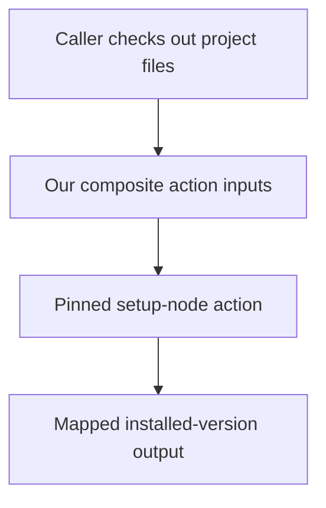

# 0057 · Create a composite action by composing pre-built actions

!!! note "Teaching brief"
    This page defines the planned lesson. Use its module guide and checked-in examples for context; develop the guided exercise in a teaching session. Written plans and assistant-run checks do not establish learner mastery.

## Prerequisites

- [0056 · Design action.yml inputs, outputs, runtimes, and failure contracts](0056-own-action-metadata-and-contracts.md)
- [Module guide](create-your-own-action.md)

## What you will learn to do

- Build a repository-specific action around a maintained setup action without adding a shell script.
- Test the action through a caller that checks out its files and provides the expected lockfile.

## Explain the Actions behavior

1. A composite action can contain uses steps and expose a narrower interface around a pre-built action.
2. The caller workspace supplies project files while the action definition supplies reusable orchestration.
3. Inputs and outputs require explicit mappings even when all internal steps are pre-built actions.

Prefer maintained pre-built actions for standard platform operations. Keep project build/test commands explicit and introduce custom code only where the required behavior needs it. Follow the [teaching guide](teaching-guide.md).

## Planned local lab

Develop the exercise under `labs/0057/` or extend the linked examples. Reuse installed tools and explain what each check proves.

1. Read examples/project-setup-action/action.yml and trace its node-version input and output.
2. Inspect examples/own-action-consumer.yml and explain checkout ordering and the lockfile path.
3. Validate metadata and plan a reviewed GitHub smoke run for Node setup and npm caching.

## Break it and diagnose it

Call the repository-local action before checkout or supply a nonexistent cache lockfile. Diagnose the missing file boundary instead of adding shell fallback logic.

Ask for a prediction before reproducing the failure. Keep permission-dependent and remote-service behavior separate from local static checks.

## Planning diagram



## Retrieval questions

1. Which parts of this action are your own interface?
2. Why does its caller still run npm ci?
3. How does the internal step output become the public action output?

## Evidence and remaining limits

Capture the learner's prediction, modified example, failure diagnosis, repair, and explanation of the appropriate test boundary. Local YAML validation does not execute a remote action or prove GitHub permissions. Hosted exercises and repository writes need a deliberate execution plan.

Use the [primary sources](../references/resources.md) and [dated action catalog](../references/prebuilt-actions.md). Recheck current releases, publisher evidence, and permissions when developing the lesson.

## Start this lesson in a new thread

```text
/teach 0057

Expand docs/lessons/0057-own-composite-action-from-prebuilt-actions.md in place.
Read docs/mission.md, NOTES.md, docs/lessons/teaching-guide.md, the module
guide, and prerequisite Actions pages. Prefer pre-built actions over shell glue.
Teach one concept at a time. Ask for predictions and exercises before revealing
solutions. Keep local checks small, distinguish hosted effects, and record only
actual learner evidence.
```

| Previous | All lessons | Next |
| --- | --- | --- |
| [0056 · Design action.yml inputs, outputs, runtimes, and failure contracts](0056-own-action-metadata-and-contracts.md) | [Curriculum](index.md) | [0058 · Create a JavaScript or TypeScript action with a tested distribution](0058-own-node-action-and-distribution.md) |
