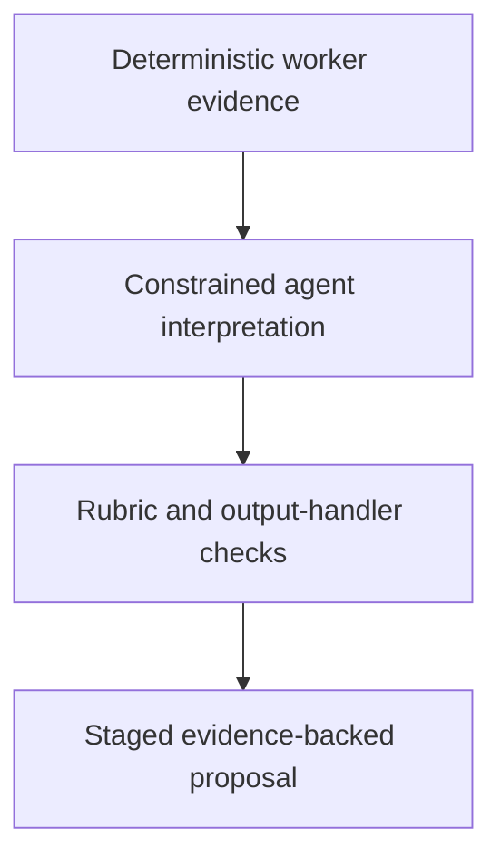

# 0058 · Add an evidence-backed agentic report with bounded proposals

!!! note "Placeholder for a future teaching thread"
    This page is a teaching brief. Expand it into a full interactive lesson in its own thread. The planned exercises and outcomes have not been completed or demonstrated.

**Level:** Professional practice.

## Prerequisites

- [0057 · Compose shared setup and reusable workflow orchestration](0057-capstone-reusable-workflow-fanout-and-fanin.md)
- [0046 · Safe outputs, staging, write limits, and human review](0046-agentic-safe-outputs-and-human-review.md)
- [0047 · Agentic fixtures, adversarial repository text, and quality evaluation](0047-agentic-fixtures-adversarial-input-and-evaluation.md)

## What you will learn to do

- Connect deterministic worker evidence to a constrained agentic report.
- Evaluate report usefulness and honesty without granting unnecessary release authority.

## Explain the Actions behavior

Start from the prerequisite workflow or action behavior and introduce these concepts with focused examples:

1. Agentic interpretation can enrich a deterministic report while release decisions remain tied to verifiable evidence.
2. The report should separate observed results, inferred suggestions, and unavailable checks.
3. Tool and output boundaries constrain the proposal independently of prompt quality.

Explain the relevant workflow YAML, expressions, and action code in context. Follow the [shared teaching guide](teaching-guide.md) for pacing, expected output, and progression toward independent design.

## Planned local lab

Create an isolated exercise under `labs/0058/` when the lesson is developed. Explain setup and expected output before each command; reuse installed tools rather than reinstalling them on every step.

1. Supply a versioned evidence fixture from the deterministic workers.
2. Define a report rubric, minimum read tools, one staged proposal, and an operation cap.
3. Compile locally, evaluate normal and adversarial fixtures, and plan a budgeted staged execution only after review.

## Break it and diagnose it

Let an agent reinterpret a failing deterministic check as a passing release gate or claim an unexecuted test succeeded.

Ask for a prediction first. Capture the smallest reproducer, the actual result, and the corrected behavior. State which remaining claim requires a real GitHub or external-service check.

## Planning diagram



When expanding this lesson, refine the diagram to show the actual processes, branches, data exchange, and trust boundaries being taught.

## Retrieval questions

1. Which conclusions are observations versus suggestions?
2. What authority does the agent need to produce a useful report?
3. How do tools and handlers enforce limits if the prompt is ignored?

## Evidence to capture in the teaching thread

- A working learner-produced example and an explanation of why it works.
- A reproduced failure, a reasoned repair, and the smallest check that verifies it.
- A short account of remaining limits, unresolved questions, and readiness for the next lesson.

Use [primary references](../references/resources.md) to verify current syntax, runtime support, and tool behavior. Add learning records only for real statements or demonstrated understanding; a placeholder or generated page does not establish mastery.

## Start this lesson in a new thread

```text
/teach 0058

Expand docs/lessons/0058-capstone-bounded-agentic-reporting.md in place using docs/lessons/teaching-guide.md.
Read docs/mission.md, NOTES.md, and the prerequisite lesson pages first.
Begin with a short check of the Actions prerequisites. Explain relevant YAML,
expressions, and action contracts, one concept at a time. Let me predict and
try each exercise before revealing its answer. Keep feedback local where possible.
Finish with retrieval questions and a truthful handoff for the next thread.
```

| Previous Lesson | All Lessons | Next Lesson |
| --- | --- | --- |
| [0057 · Compose shared setup and reusable workflow orchestration](0057-capstone-reusable-workflow-fanout-and-fanin.md) | [Curriculum](index.md) | [0059 · Exercise local checks and the hosted integration gate](0059-capstone-local-and-hosted-integration-gates.md) |
