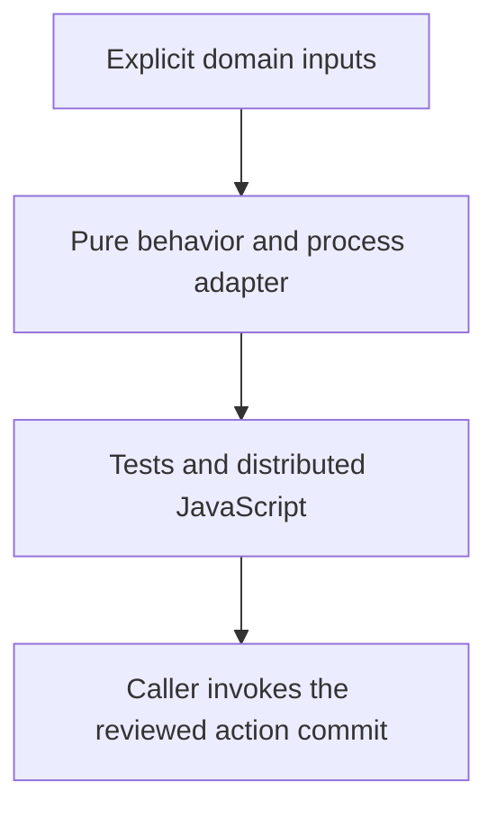

# 0058 · Create a JavaScript or TypeScript action with a tested distribution

!!! note "Teaching brief"
    This page defines the planned lesson. Use its module guide and checked-in examples for context; develop the guided exercise in a teaching session. Written plans and assistant-run checks do not establish learner mastery.

## Prerequisites

- [0057 · Create a composite action by composing pre-built actions](0057-own-composite-action-from-prebuilt-actions.md)
- [Module guide](create-your-own-action.md)

## What you will learn to do

- Implement domain logic behind a thin Node action adapter and test invalid as well as valid input.
- Package the JavaScript artifact that GitHub will execute for consumers.

## Explain the Actions behavior

1. Keep validation and transformation logic observable without process or network setup.
2. The adapter owns action input transport, output publication, diagnostics, and failed exit status.
3. TypeScript source must be built and bundled before consumers run its committed JavaScript distribution.

Prefer maintained pre-built actions for standard platform operations. Keep project build/test commands explicit and introduce custom code only where the required behavior needs it. Follow the [teaching guide](teaching-guide.md).

## Planned local lab

Develop the exercise under `labs/0058/` or extend the linked examples. Reuse installed tools and explain what each check proves.

1. Extend the existing JavaScript or TypeScript action with one useful repository-specific behavior.
2. Use the direct function and real process-adapter tests before changing workflow wiring.
3. Rebuild the TypeScript distribution explicitly and verify that stale generated output fails its check.

## Break it and diagnose it

Change TypeScript source without rebuilding the distributed bundle. Diagnose why a consumer still executes old behavior.

Ask for a prediction before reproducing the failure. Keep permission-dependent and remote-service behavior separate from local static checks.

## Planning diagram



## Retrieval questions

1. What does the consumer execute: source or distributed JavaScript?
2. Which test observes GITHUB_OUTPUT and failure status?
3. When does a Node action justify a new action instead of an existing toolkit helper?

## Evidence and remaining limits

Capture the learner's prediction, modified example, failure diagnosis, repair, and explanation of the appropriate test boundary. Local YAML validation does not execute a remote action or prove GitHub permissions. Hosted exercises and repository writes need a deliberate execution plan.

Use the [primary sources](../references/resources.md) and [dated action catalog](../references/prebuilt-actions.md). Recheck current releases, publisher evidence, and permissions when developing the lesson.

## Start this lesson in a new thread

```text
/teach 0058

Expand docs/lessons/0058-own-node-action-and-distribution.md in place.
Read docs/mission.md, NOTES.md, docs/lessons/teaching-guide.md, the module
guide, and prerequisite Actions pages. Prefer pre-built actions over shell glue.
Teach one concept at a time. Ask for predictions and exercises before revealing
solutions. Keep local checks small, distinguish hosted effects, and record only
actual learner evidence.
```

| Previous | All lessons | Next |
| --- | --- | --- |
| [0057 · Create a composite action by composing pre-built actions](0057-own-composite-action-from-prebuilt-actions.md) | [Curriculum](index.md) | [0059 · Create a Docker action with tested arguments, mounts, and outputs](0059-own-docker-action-and-image-contract.md) |
