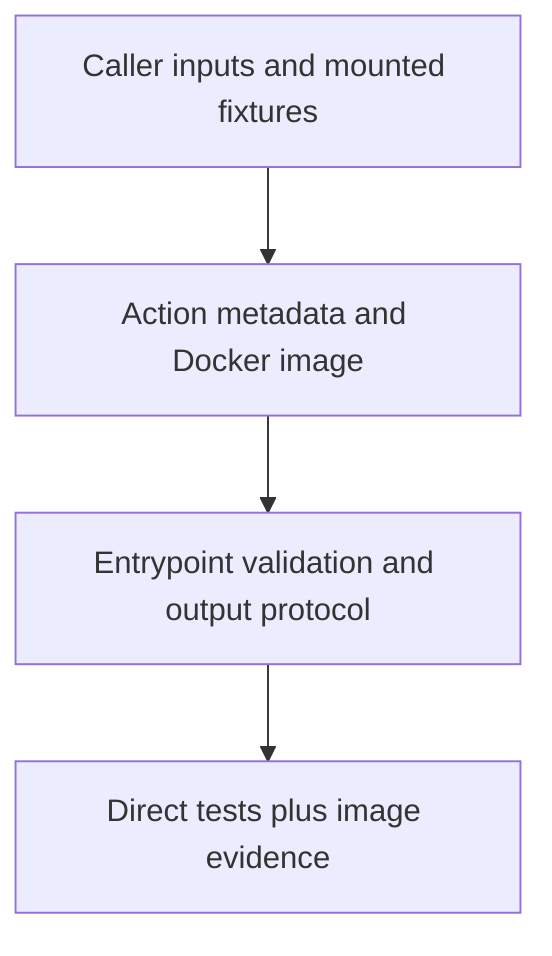

# 0059 · Create a Docker action with tested arguments, mounts, and outputs

!!! note "Teaching brief"
    This page defines the planned lesson. Use its module guide and checked-in examples for context; develop the guided exercise in a teaching session. Written plans and assistant-run checks do not establish learner mastery.

## Prerequisites

- [0058 · Create a JavaScript or TypeScript action with a tested distribution](0058-own-node-action-and-distribution.md)
- [Module guide](create-your-own-action.md)

## What you will learn to do

- Package custom runtime behavior in a Docker action with a clear metadata and filesystem contract.
- Separate host program checks from image build and container execution evidence.

## Explain the Actions behavior

1. Choose Docker for runtime packaging requirements that outweigh image startup and maintenance costs.
2. Metadata, Dockerfile, entrypoint, mounted files, and output paths are distinct interfaces.
3. A host test cannot establish image dependencies or mount permissions; an image test adds that evidence.

Prefer maintained pre-built actions for standard platform operations. Keep project build/test commands explicit and introduce custom code only where the required behavior needs it. Follow the [teaching guide](teaching-guide.md).

## Planned local lab

Develop the exercise under `labs/0059/` or extend the linked examples. Reuse installed tools and explain what each check proves.

1. Extend examples/docker-action with a bounded file-inspection operation against a fixture.
2. Run the entrypoint contract tests directly before building the image.
3. With a running engine, test valid and invalid input and the mounted output file in the built container.

## Break it and diagnose it

Write output to a guessed path instead of the runner-provided file. Diagnose the filesystem contract and verify the repair through the image boundary.

Ask for a prediction before reproducing the failure. Keep permission-dependent and remote-service behavior separate from local static checks.

## Planning diagram



## Retrieval questions

1. Which requirement makes the container useful?
2. What does a direct Python test leave unverified?
3. Which runner platforms can execute this Docker action?

## Evidence and remaining limits

Capture the learner's prediction, modified example, failure diagnosis, repair, and explanation of the appropriate test boundary. Local YAML validation does not execute a remote action or prove GitHub permissions. Hosted exercises and repository writes need a deliberate execution plan.

Use the [primary sources](../references/resources.md) and [dated action catalog](../references/prebuilt-actions.md). Recheck current releases, publisher evidence, and permissions when developing the lesson.

## Start this lesson in a new thread

```text
/teach 0059

Expand docs/lessons/0059-own-docker-action-and-image-contract.md in place.
Read docs/mission.md, NOTES.md, docs/lessons/teaching-guide.md, the module
guide, and prerequisite Actions pages. Prefer pre-built actions over shell glue.
Teach one concept at a time. Ask for predictions and exercises before revealing
solutions. Keep local checks small, distinguish hosted effects, and record only
actual learner evidence.
```

| Previous | All lessons | Next |
| --- | --- | --- |
| [0058 · Create a JavaScript or TypeScript action with a tested distribution](0058-own-node-action-and-distribution.md) | [Curriculum](index.md) | [0060 · Document, version, and publish your action for real consumers](0060-own-action-release-and-marketplace.md) |
