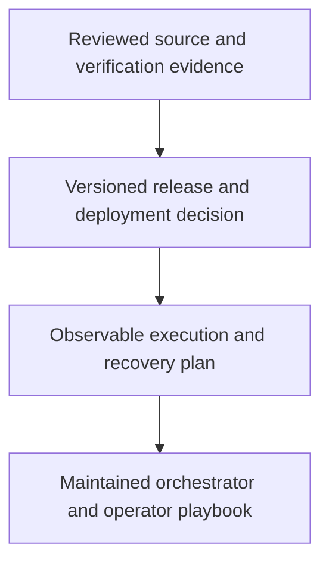

# 0060 · Release the action suite, deploy the site, and write the operating playbook

!!! note "Placeholder for a future teaching thread"
    This page is a teaching brief. Expand it into a full interactive lesson in its own thread. The planned exercises and outcomes have not been completed or demonstrated.

**Level:** Professional practice.

## Prerequisites

- [0059 · Exercise local checks and the hosted integration gate](0059-capstone-local-and-hosted-integration-gates.md)
- [0035 · Commit pins, semantic releases, major tags, and distribution integrity](0035-sha-pins-semantic-releases-and-provenance.md)
- [0036 · Logs, annotations, summaries, concurrency, and usage budgets](0036-observability-concurrency-and-usage-budgets.md)

## What you will learn to do

- Prepare a reviewable versioned release with documented compatibility and provenance.
- Explain and rehearse a bounded failure-response and recovery plan.

## Explain the Actions behavior

Start from the prerequisite workflow or action behavior and introduce these concepts with focused examples:

1. A release publishes reviewed behavior and artifacts through deliberate consumer references.
2. Deployment and rollback are operations with side effects, identities, and recovery constraints.
3. Professional ownership includes diagnostics, dependency updates, usage budgets, and a repeatable response to failure.

Explain the relevant workflow YAML, expressions, and action code in context. Follow the [shared teaching guide](teaching-guide.md) for pacing, expected output, and progression toward independent design.

## Planned local lab

Create an isolated exercise under `labs/0060/` when the lesson is developed. Explain setup and expected output before each command; reuse installed tools rather than reinstalling them on every step.

1. Review the source, bundle, image references, changelog, verification evidence, and intended consumers.
2. Prepare the release and Pages deployment steps with the required authorization and environment policy.
3. Rehearse rollback or roll-forward using a disposable scenario, then write an operator playbook and record the engineering tradeoffs actually demonstrated.

## Break it and diagnose it

Publish a new reference without matching artifacts or plan a rollback that cannot restore the prior consumer-visible behavior.

Ask for a prediction first. Capture the smallest reproducer, the actual result, and the corrected behavior. State which remaining claim requires a real GitHub or external-service check.

## Planning diagram



When expanding this lesson, refine the diagram to show the actual processes, branches, data exchange, and trust boundaries being taught.

## Retrieval questions

1. Which exact artifact and reference does a consumer receive?
2. What can be recovered after a partially completed publish?
3. What evidence shows the learner can operate the system as well as write it?

## Evidence to capture in the teaching thread

- A working learner-produced example and an explanation of why it works.
- A reproduced failure, a reasoned repair, and the smallest check that verifies it.
- A short account of remaining limits, unresolved questions, and readiness for the next lesson.

Use [primary references](../references/resources.md) to verify current syntax, runtime support, and tool behavior. Add learning records only for real statements or demonstrated understanding; a placeholder or generated page does not establish mastery.

## Start this lesson in a new thread

```text
/teach 0060

Expand docs/lessons/0060-capstone-release-deployment-and-operating-playbook.md in place using docs/lessons/teaching-guide.md.
Read docs/mission.md, NOTES.md, and the prerequisite lesson pages first.
Begin with a short check of the Actions prerequisites. Explain relevant YAML,
expressions, and action contracts, one concept at a time. Let me predict and
try each exercise before revealing its answer. Keep feedback local where possible.
Finish with retrieval questions and a truthful handoff for the next thread.
```

| Previous Lesson | All Lessons | Next Lesson |
| --- | --- | --- |
| [0059 · Exercise local checks and the hosted integration gate](0059-capstone-local-and-hosted-integration-gates.md) | [Curriculum](index.md) | [Return to curriculum](index.md) |
