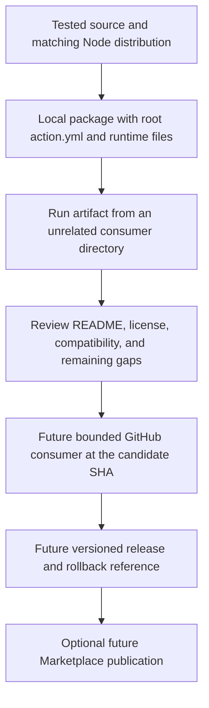

# 0060 · Document, version, and publish your action for real consumers

!!! note "Authored reference lesson"
    Assemble and test a local release candidate. Publishing is a deliberate future exercise: this lab creates no repository, commit, tag, release, or Marketplace listing. Written content and author-run checks do not establish mastery.

## Prerequisites and goal

Read [0059 · Docker interfaces](0059-own-docker-action-and-image-contract.md), [0058 · Node distribution](0058-own-node-action-and-distribution.md), and the [module guide](create-your-own-action.md). Recall [0012 · Verification limits](0012-local-hosted-coverage-and-usage-budget.md): readiness is a collection of supported claims with explicit remaining gaps.

Your goal is to assemble the tested Node release-key implementation as a single-action package, run it from an unrelated working directory, reject incomplete packages, and write a bounded release/rollback plan. You will distinguish local reuse, remote reuse at a revision, a versioned release, and an optional Marketplace listing. Commands run from the repository root using installed tools.

## Understand the four distribution milestones

A repository-local action works because checkout supplies its directory. A remote action reference asks the runner to obtain action files from another repository/revision. A tagged release adds version identity and release notes. A Marketplace listing adds discovery and publication requirements. None of these automatically proves the package works for a real consumer.

| Milestone | Example reference or artifact | Required evidence |
| --- | --- | --- |
| Local reuse | `uses: ./labs/0058/action` | Checked-out package files and working action interface |
| Remote reuse | `OWNER/REPOSITORY@FULL_COMMIT_SHA` | Actual repository access, exact revision, complete runtime files |
| Versioned release | Proposed `v1.0.0` associated with a reviewed commit | Compatibility policy, tests, release notes, known limitations |
| Marketplace listing | Published action display name and listing | Public single-action package, eligible name, agreement, listing metadata |

The remote spelling above is a template, not an existing action. A listing is not required for remote `uses` consumption. GitHub's [Marketplace publication guide](https://docs.github.com/en/actions/how-tos/create-and-publish-actions/publish-in-github-marketplace) defines public-repository, root-metadata, naming, agreement, and release requirements. A verified creator badge is a publisher identity signal, not a test result or code audit.

This learning repository holds many action examples and has no root `action.yml`. It can demonstrate local/subdirectory reuse, but extracting one action into a dedicated repository creates a clearer release unit. A Marketplace action needs root metadata; putting metadata only under `src/` or `examples/` does not satisfy that package-root requirement.



## Assemble the local package

`labs/0060/prepare.py` copies the owned 0058 action into `labs/0060/package/` and adds the prepared README, MIT license, and proposed release notes. It does not build automatically, so a stale source bundle cannot be silently repaired by packaging.

First verify the input artifact, then assemble:

```bash
node labs/0058/build.cjs --check
uv run python labs/0060/prepare.py
```

Expected: the comparison passes, followed by:

```text
Prepared labs/0060/package with root metadata, source, distribution, and release documents
Local candidate only: no repository, tag, release, or Marketplace listing created
```

The runtime-relevant structure is:

```text
labs/0060/package/
  action.yml
  dist/index.cjs
  src/domain.ts
  src/index.ts
  README.md
  LICENSE
  CHANGELOG.md
```

`action.yml` and `dist/index.cjs` are required for this consumer runtime. Source supports review and future maintenance; it does not replace executable distribution. README, license, and release notes explain the public contract and use rights. There is no runtime npm installation: this bundle uses Node built-ins only. For a different action, include every file `runs.main`, imports, Dockerfile `COPY`, or composite step needs, not just a similar-looking tree.

The candidate deliberately contains no new dependency manifest. A future standalone maintenance repository must include its own reviewed locked build/test tooling before ongoing development. The current runnable consumer snapshot is built and tested by the learning checkout's existing toolchain.

!!! tip "Prediction"
    A source-only package includes `src/index.ts`, but metadata still names `dist/index.cjs`. Does the runner compile the source? What happens if you point `uses: ./` at this multi-example course root instead of the candidate directory?

??? tip "Worked prediction"
    The runner attempts to execute the artifact named in metadata; it does not build TypeScript. A missing `dist/index.cjs` makes the package incomplete. A local `uses: ./` at the course root fails because that root has no action metadata. Select the correct action directory or extract a package whose root contains metadata.

## Document the contract a new caller needs

Read `labs/0060/package/README.md` before the smoke test. It documents:

| Public promise | Candidate policy |
| --- | --- |
| `component` | Defaults to `docs`; 1–32 lowercase ASCII label characters, beginning with a letter; no trimming |
| `channel` | Defaults to `preview`; exactly `preview` or `stable` |
| `release-key` | `${component}-${channel}`, such as `docs-stable` |
| Failure | Invalid inputs or output I/O fail; invalid input emits no success output |
| Permissions | Action uses no token; this local-path caller needs read access for checkout |
| Runtime | Metadata selects Node 24 and `dist/index.cjs` |
| Portability evidence | Host process tests passed; intended hosted OS matrix remains unverified |
| Behavior | Computes a label; no release, upload, or API write |

Explain supported platforms separately from platforms tested. A built-in-only Node implementation is a reasonable cross-platform design, but one macOS host run cannot establish a Windows support guarantee. A self-hosted runner must support the declared action runtime. A future consumer example must use a real repository and reviewed revision instead of publishing a fictitious SHA.

The candidate chooses MIT for the original lab package. It does not relicense the course or third-party tools. When extracting real code, review ownership and any bundled third-party license obligations rather than copying a license mechanically.

## Lab: consume the actual package, not the source tree

```bash
node labs/0060/check-package.cjs
```

Expected:

```text
PASS: root metadata selects a runnable distribution from a different working directory
PASS: isolated consumer received release-key=docs-stable
```

The checker verifies this lab's root metadata and expected Node runtime, reads its `runs.main` path, launches that artifact with explicit inputs from a temporary unrelated working directory, and checks the exact output record. This exposes hidden reliance on the source directory or caller project modules. The inspector supports this lab's simple metadata format; it is not a general YAML parser or GitHub runner.

The complete inactive recipe is `labs/0060/consumer.yml`. After checkout it uses the candidate rather than the development source action:

```yaml title="Candidate consumer excerpt"
- id: candidate
  uses: ./labs/0060/package # (1)!
  with:
    component: docs
    channel: stable
- name: Assert candidate public interface
  env:
    RELEASE_KEY: ${{ steps.candidate.outputs.release-key }} # (2)!
  shell: bash
  run: test "$RELEASE_KEY" = docs-stable
```

1. The package is an actual directory supplied by checkout. This local reference does not test remote repository access or a release tag.
2. The expected public result must cross the runner's named-output mapping. A local process check alone cannot evaluate this expression.

```bash
.tools/bin/actionlint labs/0060/consumer.yml
```

Expected: exit zero with no diagnostics. Saving the manual-dispatch recipe under `labs/` does not activate it. Copying it to `.github/workflows/`, committing, and dispatching would be a separate future integration exercise, not part of this local task.

## Break incomplete packages without creating tags

```bash
node labs/0060/failure-demo.cjs
```

Expected:

```text
source-only: FAIL: missing runtime file: dist/index.cjs
nested-metadata: FAIL: missing root action.yml
PASS: both incomplete release snapshots were rejected; original candidate preserved
```

The demonstration copies the candidate into temporary directories. One copy loses `dist`; another moves metadata below the root. Each checker child must exit **1** for the intended missing artifact. The demonstration exits zero only if both fail for the expected reason. No broken release is published to reproduce these mistakes.

??? tip "Diagnosis and repair"
    Start from the consumer's selected package root, locate `action.yml`, follow `runs.main`, and inspect the files that would actually ship. Restore root metadata and the tested matching distribution, then rerun package and consumer checks. Source-only repair is incomplete if metadata still references a missing generated file. A tag cannot add files that were absent from its commit.

## Design a release and rollback plan as a future exercise

The proposed `labs/0060/release-notes.md` is explicitly unreleased. Fill its evidence fields with actual observations when performing a real release. A defensible future sequence is:

1. Extract this one package into a dedicated action repository, include maintenance tooling/tests, confirm licensing and Marketplace name availability, and review all runtime files.
2. Rebuild deliberately; type-check and test; compare distribution without repairing it; inspect the complete candidate diff and dependency pins. Record the full candidate commit.
3. Test a bounded real consumer against that exact full commit SHA. Use only required permissions, a manual trigger, a timeout, and explicit output assertions. Exercise the intended runner matrix before promising it.
4. Choose the version from the compatibility policy. Prepare release notes identifying the commit, actual consumer evidence, known limits, and rollback target. Only then deliberately tag and release the reviewed revision.
5. Publish a Marketplace listing if intended, following GitHub's current requirements and agreement. Listing publication is a separate deliberate action.

Do not execute remote writes during this lab. The future consumer template is `uses: OWNER/REPOSITORY@REVIEWED_FULL_COMMIT_SHA`; replace every placeholder with evidence-backed values when that repository exists. GitHub's [secure-use reference](https://docs.github.com/en/actions/reference/security/secure-use#using-third-party-actions) discusses reviewed references and dependency controls. Full commit pins identify exact content, while version or major aliases need a documented update policy and review.

For this API, changing `docs-preview` to `v2-docs-preview`, removing a public input/output, or rejecting previously accepted values is breaking behavior. Adding a compatible input or supported channel can be minor; a compatible correction can be patch. Record actual supported behavior rather than inferring compatibility from a tag name.

A movable `v1` alias is a convenience for consumers that intentionally accept updates. A consumer requiring reviewed content should retain a full SHA and its release association. Keep version releases immutable under the chosen policy. Repository release protections may constrain tag updates; account for them rather than blindly force-moving a tag. Rollback normally restores the consumer's last known-good SHA; a corrected action gets a new version/commit.

## Transfer exercise and retrieval

You discover that the release-key action now trims component whitespace, accepts `nightly`, and prefixes every key with `v2-`. Classify the combined release, list the evidence to rerun, and write a two-sentence migration note. Explain how a consumer pinned to the old commit behaves until it updates.

1. Why does root metadata matter for this candidate?
2. Which generated file must ship with its TypeScript source?
3. What does a local consumer leave unverified?
4. How does a real consumer recover from a bad new release?

??? tip "Worked transfer and retrieval"
    The key prefix is a breaking output change, so the combined release requires a major version regardless of the compatible channel addition. Test the new accepted-input policy and key spelling, rebuild/recompare, rerun package checks, and obtain bounded hosted consumer evidence for the declared platforms. Explain the new key prefix and any migration of artifact or downstream names. An old full-SHA consumer continues to execute the old package. Root metadata identifies the standalone action; `dist/index.cjs` supplies its runtime. Local checks do not prove remote resolution, permissions, hosted runner compatibility, or Marketplace eligibility. Restore the consumer's known-good SHA to roll back, and issue a separately reviewed fixed release.

## Verification limits and module handoff

Local readiness includes working program contracts, matching distribution, a complete candidate package, and static recipes. It does not include a successful remote consumer, the full intended OS matrix, a container run when the engine is unavailable, or any publication. Exact executed and deferred checks, sources checked on **2026-10-30**, and unresolved integration boundaries are persisted in `labs/module-3-handoff.md`. Documentation validation remains for the coordinator's combined 24-lesson pass.

A guided teaching handoff should record the learner's package diagnosis, compatibility reasoning, and rollback explanation only when demonstrated. Module 3's creation path is complete as authored material. Continue in catalog order to [0013 · Docker metadata and lifecycle](0013-docker-action-metadata-and-lifecycle.md); IDs stay stable even though the next module uses lower numbers.

## Start this lesson in a new thread

```text
/teach 0060

Use docs/lessons/0060-own-action-release-and-marketplace.md and labs/0060/.
Read docs/mission.md, NOTES.md, docs/lessons/teaching-guide.md, lessons 0059,
0058, and 0012. Ask me to inspect the package and predict both broken snapshots.
Pause before solutions. Keep release/Marketplace steps as future exercises
unless separately requested; record actual evidence and continue to lesson 0013.
```

| Previous Lesson | All Lessons | Next Lesson |
| --- | --- | --- |
| [0059 · Docker image and interface](0059-own-docker-action-and-image-contract.md) | [Curriculum](index.md) | [0013 · Docker metadata and lifecycle](0013-docker-action-metadata-and-lifecycle.md) |
