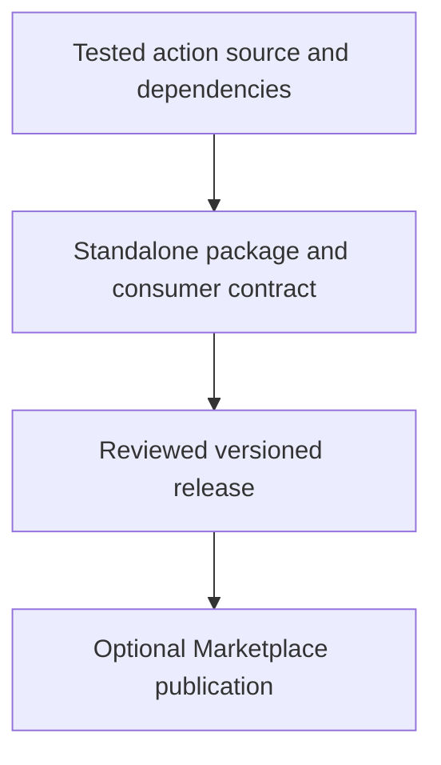

# 0060 · Document, version, and publish your action for real consumers

!!! note "Teaching brief"
    This page defines the planned lesson. Use its module guide and checked-in examples for context; develop the guided exercise in a teaching session. Written plans and assistant-run checks do not establish learner mastery.

## Prerequisites

- [0059 · Create a Docker action with tested arguments, mounts, and outputs](0059-own-docker-action-and-image-contract.md)
- [Module guide](create-your-own-action.md)

## What you will learn to do

- Prepare a standalone action repository with documented compatibility and a reviewed consumer example.
- Distinguish repository-local reuse, a tagged release, and a Marketplace listing.

## Explain the Actions behavior

1. A standalone Marketplace action repository needs its action metadata at the root and the action-specific runtime files.
2. A release binds source, generated distribution, documentation, and the consumer reference being reviewed.
3. Use release automation where appropriate and verify the actual consumer before promising compatibility.

Prefer maintained pre-built actions for standard platform operations. Keep project build/test commands explicit and introduce custom code only where the required behavior needs it. Follow the [teaching guide](teaching-guide.md).

## Planned local lab

Develop the exercise under `labs/0060/` or extend the linked examples. Reuse installed tools and explain what each check proves.

1. Plan extracting one example into a single-action repository without publishing it during this lesson automatically.
2. Write its input/output documentation, license choice, compatibility matrix, and consumer workflow.
3. Prepare release notes and a reviewed release plan that includes generated files and upstream action pins.

## Break it and diagnose it

Tag a source-only TypeScript tree or point a consumer to a root without action.yml. Diagnose the missing runtime artifact or package root before publishing again.

Ask for a prediction before reproducing the failure. Keep permission-dependent and remote-service behavior separate from local static checks.

## Planning diagram



## Retrieval questions

1. Why is this multi-example learning repository different from a standalone Marketplace action?
2. Which files must ship in a TypeScript action release?
3. What release and rollback evidence should a real consumer see?

## Evidence and remaining limits

Capture the learner's prediction, modified example, failure diagnosis, repair, and explanation of the appropriate test boundary. Local YAML validation does not execute a remote action or prove GitHub permissions. Hosted exercises and repository writes need a deliberate execution plan.

Use the [primary sources](../references/resources.md) and [dated action catalog](../references/prebuilt-actions.md). Recheck current releases, publisher evidence, and permissions when developing the lesson.

## Start this lesson in a new thread

```text
/teach 0060

Expand docs/lessons/0060-own-action-release-and-marketplace.md in place.
Read docs/mission.md, NOTES.md, docs/lessons/teaching-guide.md, the module
guide, and prerequisite Actions pages. Prefer pre-built actions over shell glue.
Teach one concept at a time. Ask for predictions and exercises before revealing
solutions. Keep local checks small, distinguish hosted effects, and record only
actual learner evidence.
```

| Previous | All lessons | Next |
| --- | --- | --- |
| [0059 · Create a Docker action with tested arguments, mounts, and outputs](0059-own-docker-action-and-image-contract.md) | [Curriculum](index.md) | [0013 · Docker action metadata, arguments, and container lifecycle](0013-docker-action-metadata-and-lifecycle.md) |
