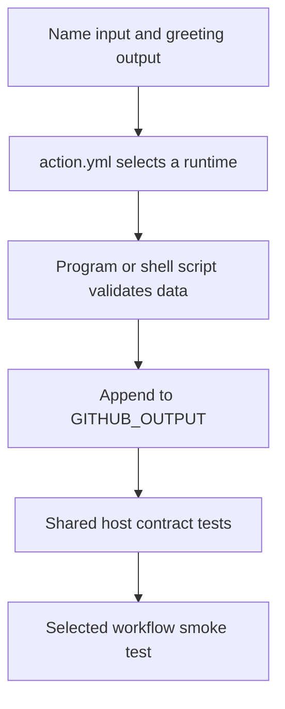

# One contract, four action implementations

These starter labs implement the same contract: a nonempty, single-line name produces `greeting=Hello, <trimmed name>!` in `GITHUB_OUTPUT`. Invalid input fails without publishing a success output. Missing input defaults to `World`; an explicitly empty input is invalid.

The implementations are intentionally small so you can inspect input transport, process boundaries, and output mapping. Start with the [create-your-own-action module](create-your-own-action.md), then follow the Docker, Node, and composite deep dives to extend them with real repository automation.



## Docker container action

Files: [Docker action source](https://github.com/Rohit1024/actions-learn/tree/main/examples/docker-action).

`action.yml` passes the name through `runs.args`. The Dockerfile copies a Python entrypoint into a Linux image. The program uses its first argument, validates it, and appends the greeting to the runner-provided output path. Its entrypoint can also run directly with host Python, which keeps the inner development loop short.

```yaml
runs:
  using: docker
  image: Dockerfile
  args:
    - ${{ inputs.name }}
```

```bash
task test
task test:container
```

The first command tests the Python program's contract. The second builds/runs the image and checks the mounted output file. Docker container actions require a Linux runner with container support; see [GitHub's container action tutorial](https://docs.github.com/en/actions/tutorials/use-containerized-services/create-a-docker-container-action).

**Extend it:** make the program inspect a mounted fixture directory. Test missing files and nonzero exits before adding a workflow invocation. The starter uses the readable `python:3.14-alpine` tag; the release lesson covers pinning a reviewed image digest.

## JavaScript action

Files: [JavaScript action source](https://github.com/Rohit1024/actions-learn/tree/main/examples/javascript-action).

`greet.cjs` is a pure function. `index.cjs` is a thin process adapter: read `INPUT_NAME`, call the function, append the output, and set a failure exit code on error.

```yaml
runs:
  using: node24
  main: index.cjs
```

```bash
npm test
task test
```

This first implementation uses Node's standard library to expose the output-file protocol. The JavaScript/TypeScript module introduces the Actions Toolkit for input parsing, annotations, API clients, and lifecycle state. Read the [official JavaScript action tutorial](https://docs.github.com/en/actions/tutorials/create-actions/create-a-javascript-action).

**Extend it:** add a repository API adapter and inject a fake client into the business logic. Test pagination, rate-limit responses, missing data, and authentication errors without real API calls.

## TypeScript-authored action

Files: [TypeScript action source and bundle](https://github.com/Rohit1024/actions-learn/tree/main/examples/typescript-action).

TypeScript is an authoring language here. GitHub executes the bundled CommonJS file `dist/index.cjs`; it does not install dependencies or compile `src/index.ts` for action consumers.

```bash
task actions:build
task test
```

The `check:dist` command compares a temporary esbuild result against the committed bundle. This catches source changes that were never packaged. Both the source and bundle belong in a release.

**Extend it:** replace the deterministic greeting with a small, typed report function. Keep API access in an adapter and preserve pure tests for the report logic.

## Composite action

Files: [Composite action source](https://github.com/Rohit1024/actions-learn/tree/main/examples/composite-action).

The composite explicitly maps `${{ inputs.name }}` into `GREETING_NAME`. Its Bash step runs a script from `$GITHUB_ACTION_PATH`. Its action output maps back to `steps.greet.outputs.greeting`.

```yaml
outputs:
  greeting:
    description: The validated greeting
    value: ${{ steps.greet.outputs.greeting }}
```

```bash
task test
task act:smoke
```

Host tests verify the extracted script; the smoke workflow exercises the YAML mapping. See the [composite action tutorial](https://docs.github.com/en/actions/tutorials/create-actions/create-a-composite-action).

**Extend it:** combine setup, build, and validation steps. When reuse requires multiple jobs or its own runner choices, evaluate a reusable workflow with `workflow_call`.

## Compare failure evidence

| Change | First useful check |
| --- | --- |
| Greeting validation | `task test` |
| TypeScript source or packaging | `task actions:build`, then `task test` |
| Docker base, copied file, or entrypoint | `task test:container` |
| Composite output mapping | `task lint:workflows`, then `task act:smoke` |
| Token permissions or environment protection | Reviewed GitHub integration run |

## Exercise

Add a `language` input to one action and define its valid values. Write a failing contract test, implement the behavior, and update metadata and documentation. Decide whether you changed only action behavior or also workflow wiring, then run the corresponding checks.

| Previous | All lessons | Next |
| --- | --- | --- |
| [Local testing guide](../cheatsheet/local-testing.md) | [Curriculum](index.md) | [Agentic Workflows lab](agentic-workflows.md) |
