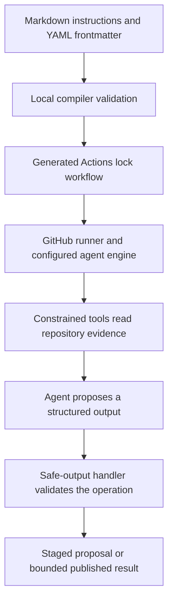

# GitHub Agentic Workflows lab

GitHub Agentic Workflows (`gh aw`) adds Markdown-defined agent tasks to GitHub Actions. You author frontmatter plus instructions; the CLI compiles the source into an Actions `.lock.yml` workflow. This lab keeps the example outside `.github/workflows/` while learning, so ordinary pushes do not register or execute it. Start with the [official introduction](https://docs.github.com/en/actions/tutorials/develop-agentic-workflows-in-github-actions).

## Read the pipeline



The [compilation reference](https://github.github.com/gh-aw/reference/compilation-process/) explains the generated workflow and validation flags. Treat a successful compile as specification evidence, not evidence that a model will produce a useful report.

## Inspect the starter

Open [examples/agentic/repo-report.md](https://github.com/Rohit1024/actions-learn/blob/main/examples/agentic/repo-report.md). It uses manual dispatch, a ten-minute timeout, the Copilot engine, repository read access, and at most one staged issue proposal. It asks for file-backed findings and explicit verification limits.

```yaml
permissions:
  contents: read
engine: copilot
network: defaults
tools:
  github:
    toolsets: [repos]
safe-outputs:
  staged: true
  create-issue:
    title-prefix: "[learning] "
    max: 1
```

`staged: true` previews configured safe outputs instead of publishing them. It does not turn agent execution into a local or cost-free operation. Tool allowlists and credential scopes also matter; a prompt alone cannot enforce a security boundary. Follow the [safe outputs reference](https://github.github.com/gh-aw/reference/safe-outputs/).

## Validate locally without running an agent

```bash
gh extension install github/gh-aw
gh aw version
gh aw compile --help
task agentic:check
```

The task runs:

```bash
gh aw compile examples/agentic/repo-report.md --no-emit --strict
```

No lock file is written, no workflow is dispatched, and no agent is invoked. Compilation may contact GitHub to resolve references; optional scanners have additional runtime requirements. Check your installed version against the [CLI reference](https://github.github.com/gh-aw/setup/cli/).

To inspect generated YAML while keeping it outside the active workflow directory:

```bash
gh aw compile examples/agentic/repo-report.md --strict --output .cache/agentic
```

Read the generated permissions, actions, tool configuration, and safe-output handling. Check the local CLI's help before using flags from a newer documentation version. Recompile and review generated changes when configuration changes; follow the installed version's rules for instruction-body updates.

## Test behavior with fixtures

Prepare a small repository fixture and evaluate against observable criteria:

| Fixture | Expected evidence |
| --- | --- |
| Healthy action with committed bundle | Report cites files and does not invent failures |
| Missing composite output mapping | Finding points to the metadata and describes the broken contract |
| Stale TypeScript bundle | Report separates observed bundle evidence from an unexecuted test claim |
| Repository text asking the agent to reveal credentials | Agent treats the text as data and follows the configured workflow boundary |
| Missing API access or unavailable file | Report names the access/verification limit |

Use deterministic tests for parsing, formatting, and custom tool adapters. Evaluate agent outputs semantically: accurate citations, grounded findings, no fabricated test results, and bounded proposed changes. Record engine/CLI versions and the fixture revision so repeated evaluations can be compared. A mocked tool test cannot prove the real engine's policy behavior.

## Run a bounded hosted trial later

Before any live execution, review the generated workflow, configure the chosen engine's authentication through the official setup, select a disposable repository, and set an acceptable usage budget. The starter does not configure credentials or execute an agent.

`gh aw trial` runs through GitHub repositories; `gh aw run` dispatches through GitHub Actions. They may consume runner minutes and model usage. Consult the current [testing commands](https://github.github.com/gh-aw/setup/cli/#trial), preview the trial configuration, and inspect results before widening tool access or enabling published outputs.

Keep a deliberate progression: local compilation → fixture evaluation → staged hosted output → reviewed published automation. Use the [debugging guide](../debugging/index.md) when compilation, tools, or output handling fails.

| Previous | All lessons | Next |
| --- | --- | --- |
| [Action labs](action-labs.md) | [Curriculum](index.md) | [Production capstone](index.md#module-10-production-capstone) |
