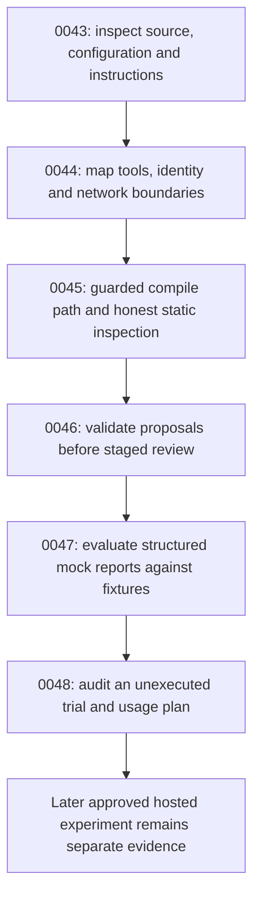

# GitHub Agentic Workflows lab

Module 8 develops a bounded repository report through six reference lessons. Start at [0043](0043-agentic-markdown-and-compiled-workflows.md) after [0042](0042-compose-maintained-actions-and-manage-updates.md). Written content and assistant checks do not establish learner mastery.

The local exercises need the already-installed Python environment, PyYAML, and actionlint. They neither call a model nor publish an output. On **2026-10-30**, GitHub CLI 2.96.0 was installed but its gh-aw extension was absent. The Docker compatibility command could not connect to its Podman socket. Consequently, no actual compile, container execution, or hosted agent execution is claimed.

## Follow the evidence boundaries



| Lesson | Observable local result | Remaining gap |
| --- | --- | --- |
| [0043 · Sources and stages](0043-agentic-markdown-and-compiled-workflows.md) | Separate frontmatter/body fingerprints and false runtime claims | Compiler and runtime behavior |
| [0044 · Engines and capabilities](0044-agentic-engines-tools-and-authentication.md) | Allow/deny decisions in a normalized teaching policy | Actual identities, firewall and tool enforcement |
| [0045 · Compilation and generated workflows](0045-agentic-local-compilation-and-generated-yaml.md) | Schematic inspection and explicit actionlint result | Actual compilation blocked by missing extension |
| [0046 · Safe outputs and review](0046-agentic-safe-outputs-and-human-review.md) | Local preview; six unsafe proposal cases rejected | Real handler and platform approval |
| [0047 · Adversarial fixtures and evaluation](0047-agentic-fixtures-adversarial-input-and-evaluation.md) | Five mock cases; paraphrase acceptance and eight rejected defects | Model behavior and general semantic correctness |
| [0048 · Trials and diagnostics](0048-agentic-hosted-trials-budgets-and-diagnostics.md) | Consistent plan, blocked readiness and classified synthetic failures | Hosted execution, usage and partial effects |

## Run the deterministic path

Run from the repository root. These commands use existing dependencies and no external service:

```bash
.venv/bin/python labs/0043/inventory.py
.venv/bin/python labs/0043/exercise.py
.venv/bin/python labs/0044/boundary.py labs/0044/policy.json
.venv/bin/python labs/0044/exercise.py
.venv/bin/python labs/0045/inspect_lock.py labs/0045/illustrative.lock.yml
.venv/bin/python labs/0045/exercise.py
.tools/bin/actionlint labs/0045/illustrative.lock.yml
.venv/bin/python labs/0046/review.py labs/0046/valid.json
.venv/bin/python labs/0046/exercise.py
.venv/bin/python labs/0047/evaluate.py labs/0047/reports/grounded.json
.venv/bin/python labs/0047/exercise.py
.venv/bin/python labs/0048/plan.py labs/0048/plan.json
.venv/bin/python labs/0048/diagnose.py
.venv/bin/python labs/0048/exercise.py
```

All should exit 0. Actionlint should print no diagnostics. Each exercise labels its intentionally rejected cases; those internal failures are expected. Each lesson separately gives commands whose direct exit 1 is the desired negative result. Do not include `labs/0045/fixtures/unsafe.lock.yml` in a positive workflow-lint command.

`illustrative.lock.yml` is hand-written ordinary Actions YAML. It prints schematic stage labels and does not invoke an engine or an actual safe-output handler. The local proposal envelope, capability policy, rubric reports, trial plan, and diagnostic events are teaching formats rather than gh-aw schemas or real run receipts.

## Keep optional compilation distinct

Inspect tooling without installing or changing credentials:

```bash
gh aw version
gh aw compile --help
.venv/bin/python labs/0045/compile_local.py
```

With the currently missing extension, the wrapper exits 2 and records `compiler not invoked`. If a compatible compiler is already installed later, it checks flags and compiles a copy in a temporary independent repository beneath the lab. No-emit strict validation does not invoke an agent. An explicit `--emit` request copies only actual compiler locks into `labs/0045/generated/` for inspection. There are no emitted files from this authoring run.

The source `labs/0043/repo-report.md` copies and narrows the unchanged shared `examples/agentic/repo-report.md`: manual dispatch, contents read, explicit file-read tool, disabled Bash commands, four-turn limit, and one staged issue operation. Engine authentication remains an unresolved hosted prerequisite. Compilation may need network reference resolution; a successful local compile would still leave model quality and platform behavior unverified.

The [official tutorial](https://docs.github.com/en/actions/tutorials/develop-agentic-workflows-in-github-actions), [compiler reference](https://github.github.com/gh-aw/reference/compilation-process/), [tool reference](https://github.github.com/gh-aw/reference/tools/), and [staged-mode guide](https://github.github.com/gh-aw/reference/staged-mode/) supply the primary contracts. Check installed help before adopting evolving flags or schemas.

## Plan hosted work separately

`trial` and `run` are hosted paths with possible runner and model consumption. Staging previews configured output operations while analysis still executes. It does not control unrelated direct-write tools or make usage free. The saved plan remains unexecuted and fails `--require-ready` on five unresolved prerequisites. Nothing in this guide authorizes a dispatch or changes credentials.

Before a later experiment, select a disposable execution repository, inspect actual compiled jobs and references, bind source/evidence revisions, verify engine authentication, set observable usage limits, and define stop/partial-effect review conditions. Preserve the distinction between a successful smoke run, a repeated quality evaluation, and a publication decision. The [local testing guide](../cheatsheet/local-testing.md) covers the wider Actions feedback loop.

| Previous Lesson | All Lessons | Next Lesson |
| --- | --- | --- |
| [0042 · Action composition](0042-compose-maintained-actions-and-manage-updates.md) | [Curriculum](index.md) | [0043 · Agentic sources and execution stages](0043-agentic-markdown-and-compiled-workflows.md) |
