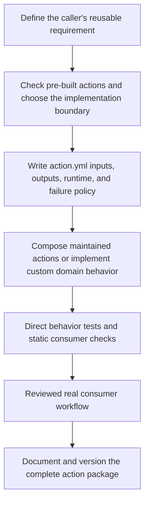

# Create your own GitHub action

Build your own action when a reusable interface or domain behavior is missing from the maintained catalog. Begin by composing existing actions, then add custom JavaScript/TypeScript or Docker behavior where the requirement justifies it.

**Module 9 · Lessons 0049–0054.** Continue after [agentic workflow trials and diagnostics](0048-agentic-hosted-trials-budgets-and-diagnostics.md). This module brings together the earlier Docker, Node, composition, security, and [pre-built action selection](prebuilt-actions.md) lessons to create a focused interface and a local release candidate.

## The six lessons

| Lesson | Developed coverage |
| --- | --- |
| [0049 · Decide when to reuse, compose, or create your own action](0049-reuse-compose-or-create-an-action.md) | Choose a pre-built action, composite action, Node action, Docker action, or reusable workflow for a concrete need. |
| [0050 · Design action.yml inputs, outputs, runtimes, and failure contracts](0050-own-action-metadata-and-contracts.md) | Write metadata that documents defaults, required inputs, outputs, and runtime behavior. |
| [0051 · Create a composite action by composing pre-built actions](0051-own-composite-action-from-prebuilt-actions.md) | Build a repository-specific action around a maintained setup action without adding a shell script. |
| [0052 · Create a JavaScript or TypeScript action with a tested distribution](0052-own-node-action-and-distribution.md) | Implement domain logic behind a thin Node action adapter and test invalid as well as valid input. |
| [0053 · Create a Docker action with tested arguments, mounts, and outputs](0053-own-docker-action-and-image-contract.md) | Package custom runtime behavior in a Docker action with a clear metadata and filesystem contract. |
| [0054 · Document, version, and publish your action for real consumers](0054-own-action-release-and-marketplace.md) | Prepare a standalone action repository with documented compatibility and a reviewed consumer example. |

## Run the isolated creation path

All six reference lessons are developed in place, with new implementations kept under their own lab directories. Written content and assistant-run checks do not establish learner mastery. Run commands from the repository root with the existing installed dependencies.

| Lesson | Developed lab | Smallest useful local observation |
| --- | --- | --- |
| 0049 | `labs/0049/decision-record.md` | Choose reuse boundaries; compare the existing adapters with `uv run python scripts/test_actions.py` |
| 0050 | `labs/0050/action/`, `probe.cjs`, `consumer.yml` | `node labs/0050/probe.cjs` checks actual validation, status, and output records |
| 0051 | `labs/0051/action/`, `preflight.py`, `consumer.yml` | `uv run python labs/0051/preflight.py` checks caller files; it does not execute setup-node |
| 0052 | `labs/0052/action/`, `build.cjs`, `test.cjs`, `stale-demo.cjs`, `consumer.yml` | `node labs/0052/build.cjs --check` and `node --test labs/0052/test.cjs` inspect the shipped release-key action |
| 0053 | `labs/0053/action/`, `fixtures/`, `contract.py`, `consumer.yml` | `uv run python labs/0053/contract.py` tests the entrypoint; a built image is a separate boundary |
| 0054 | `labs/0054/package/`, package tools, and `consumer.yml` | `node labs/0054/check-package.cjs` consumes the assembled local snapshot |

The labs include inactive recipes, explicit expected results, and temporary failure demonstrations. No recipe under `labs/` registers a hosted workflow. The Node action computes a label without releasing anything; the Docker example demonstrates bounded workspace inspection. These packaging exercises apply the Docker and Node contracts developed earlier in the course.

`labs/module-9-handoff.md` records exact authoring commands, observed results, primary URLs checked on 2026-10-30, and deferred boundaries. Documentation validation is reserved for the coordinator's single combined 24-lesson pass. Hosted consumer execution, remote release creation, and Marketplace publication remain deliberate future exercises.

## Choose the implementation boundary

| Requirement | First choice |
| --- | --- |
| A maintained action already satisfies the task | Use the pre-built action with reviewed inputs and permissions |
| Your team repeats a sequence of existing steps | A composite action with a small public interface |
| You need new validation, transformation, or API behavior | A JavaScript/TypeScript action with a thin adapter |
| You need a packaged Linux runtime or tools | A Docker action, accounting for its image and startup costs |
| Reuse must select runners or orchestrate multiple jobs | A reusable workflow |

See GitHub's [metadata reference](https://docs.github.com/en/actions/reference/workflows-and-actions/metadata-syntax) for action interfaces and its [composite tutorial](https://docs.github.com/en/actions/tutorials/create-actions/create-a-composite-action) for packaging reusable steps.

## Build a first composite without shell code

The new [project-setup-action](https://github.com/Rohit1024/actions-learn/tree/main/examples/project-setup-action) owns a team-specific contract around the maintained `actions/setup-node` action. Its complete `action.yml` is:

```yaml
name: Project Node setup
description: Configure the project's Node runtime and npm download cache through maintained actions.
inputs:
  node-version:
    description: Node version required by the caller.
    default: '24'
  cache-dependency-path:
    description: Lockfile path relative to the checked-out caller workspace.
    default: package-lock.json
outputs:
  node-version:
    description: The installed Node version.
    value: ${{ steps.node.outputs.node-version }}
runs:
  using: composite
  steps:
    - uses: actions/setup-node@949feb2413d6458794dcd2491c4babbbce0c15c1 # v7.1.0
      id: node
      with:
        node-version: ${{ inputs.node-version }}
        cache: npm
        cache-dependency-path: ${{ inputs.cache-dependency-path }}
```

The two inputs select the Node version and caller lockfile. `runs.using: composite` packages the internal `uses` step. The public output explicitly maps the installed Node version from that step. The action configures the runtime and npm download cache; the caller owns dependency installation and its tests.

After checkout, a caller can invoke it with:

```yaml
- uses: ./examples/project-setup-action # (1)!
  id: project
  with:
    node-version: '24'
    cache-dependency-path: package-lock.json
- run: npm ci
- run: npm test
```

1. The action path resolves inside the checked-out repository. Checkout must run before this step; the supplied lockfile path belongs to the caller workspace.

The complete [consumer recipe](https://github.com/Rohit1024/actions-learn/blob/main/examples/own-action-consumer.yml) includes checkout and a manual trigger. It stays inactive under `examples/` until deliberately enabled for a hosted exercise.

**Predict:** what happens if the caller omits checkout or names a missing lockfile? What does an npm cache hit actually supply? Change one input, then explain the action contract before choosing a check.

## Add custom behavior only where needed

Use the [four existing action implementations](action-labs.md) for a custom domain operation. They all expose the same validated greeting input/output contract, so the packaging tradeoffs are visible without unrelated application complexity.

| Implementation | Source directory | Main responsibility |
| --- | --- | --- |
| JavaScript | `examples/javascript-action/` | Validate input in a pure function; adapt environment input, output files, and failure status |
| TypeScript | `examples/typescript-action/` | Add typed contracts and distribute a committed executable JavaScript bundle |
| Docker | `examples/docker-action/` | Package a runtime, accept metadata arguments, and honor mounted output paths |
| Script-based composite | `examples/composite-action/` | Map inputs and outputs around an extracted script when that behavior needs a script |

Start with explicit inputs, defaults, invalid cases, outputs, and failure behavior. Metadata's `required` flag does not implement runtime input validation. Keep custom domain logic testable without a runner, while the adapter owns process and filesystem interaction.

## Check the appropriate boundary

```bash
task lint:recipes
task test
```

`lint:recipes` checks the consumer workflows and the local composite metadata. `task test` checks the existing JavaScript function and four process adapters, including invalid inputs and output files. It does not execute the remote setup action inside the new composite.

When TypeScript source changes, use `task actions:build` before rechecking the distributed artifact. When Docker packaging changes, use `task test:container` with a running engine. A reviewed GitHub consumer run establishes actual action wiring, runtime setup, cache behavior, and platform permissions.



## Prepare a standalone release

1. Put the chosen action's metadata at the root of a dedicated action repository and include its required runtime files.
2. Document inputs, defaults, outputs, errors, supported platforms, permissions, and a consumer example. Include an appropriate license.
3. For TypeScript, include the generated JavaScript distribution that the consumer executes; do not publish only the source tree.
4. Verify a real consumer against the reviewed release commit, then prepare a versioned release. Use maintained release automation where it fits.
5. Publish a Marketplace listing when intended, following GitHub's [publication requirements](https://docs.github.com/en/actions/how-tos/create-and-publish-actions/publish-in-github-marketplace). A repository-local action, a tagged action release, and a Marketplace listing are separate milestones.

This learning repository contains multiple examples and has no root `action.yml`. Extract the selected package for a standalone Marketplace release. The course update does not create another repository or publish an action release.

**Failure exercise:** point a consumer at a package without root metadata, or change TypeScript source without rebuilding its distribution. Diagnose what the consumer actually receives and verify the repaired package.

**Retrieval:** justify your runtime choice, trace an input to a public output, identify the smallest useful tests, and describe the evidence a release consumer needs.

| Previous | All lessons | Next |
| --- | --- | --- |
| [0048 · Hosted trials and diagnostics](0048-agentic-hosted-trials-budgets-and-diagnostics.md) | [Curriculum](index.md) | [0049 · Reuse, compose, or create](0049-reuse-compose-or-create-an-action.md) |
