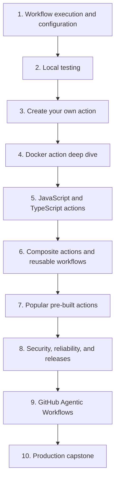

# GitHub Actions curriculum

**60 GitHub Actions lessons in 10 modules.** Learn workflow execution, test locally, build custom actions, then study maintained pre-built actions before security and releases. Progress toward a verified production orchestrator.

There are **30 authored lessons** across Modules 1–5 and **30 detailed teaching briefs** in Modules 6–10, with no starter pages. Checked items track written content, not mastery. Authored lessons include local labs, explained examples, failure exercises, retrieval questions, and guided-session prompts. The module guides also include a dated action catalog and composition recipes.

Use `task test:labs` for the Module 2–5 host exercises and `task lint:labs` for all 23 syntax-valid lab workflow recipes. Deliberate diagnostic fixtures remain separate; container and hosted evidence limits are documented in each lesson.

**Follow module order below.** Lesson IDs are stable identifiers: the new lessons use 0049–0060 so existing published lesson URLs remain valid. Previous/next links follow this learning order.

Every session includes a model, prediction, runnable experiment, failure diagnosis, and retrieval exercise. Use `/teach 0001` to begin. Prefer maintained pre-built actions for platform operations and keep necessary project build/test commands explicit.

[Start at 0001](0001-execution-model.md){ .md-button .md-button--primary }
[Pre-built actions](prebuilt-actions.md){ .md-button }
[Create your own action](create-your-own-action.md){ .md-button }

## Module 1: Workflow execution and configuration

**Outcome:** predict which events admit a run, which process runs a step, where values cross boundaries, and how required job results join. All six reference lessons are authored, with exercises under `labs/0001/`–`labs/0006/`; use `task lint:module1` to check the inactive workflow recipes together.

- [x] **0001:** [Events, workflows, jobs, steps, and the execution model](0001-execution-model.md)
- [x] **0002:** [Build a local feedback loop before the first push](0002-local-feedback-loop.md)
- [x] **0003:** [Event payloads, branch filters, path filters, and manual dispatch](0003-events-payloads-and-filters.md)
- [x] **0004:** [Contexts, expressions, conditions, status, and input types](0004-contexts-expressions-and-conditions.md)
- [x] **0005:** [Environment files and step, job, and workflow output contracts](0005-environment-files-and-output-contracts.md)
- [x] **0006:** [Matrices, job dependencies, cancellation, and failure propagation](0006-matrices-dependencies-and-cancellation.md)

## Module 2: Testing locally with Task and act

**Outcome:** reproduce a failure without a remote edit/push/rerun cycle. Keep the [local lab](../cheatsheet/local-testing.md) open.

- [x] **0007:** [Taskfile as the command contract shared by humans and CI](0007-taskfile-shared-command-contract.md)
- [x] **0008:** [Workflow linting, shell diagnostics, metadata checks, and security analysis](0008-workflow-shell-and-security-linting.md)
- [x] **0009:** [Unit tests, event fixtures, and temporary output files](0009-unit-tests-fixtures-and-output-files.md)
- [x] **0010:** [Container engines, Linux images, sockets, and CPU architecture](0010-container-engines-images-and-architecture.md)
- [x] **0011:** [Run one event and one job with act](0011-act-targeted-workflow-smoke-tests.md)
- [x] **0012:** [Define the local/hosted coverage boundary and usage budget](0012-local-hosted-coverage-and-usage-budget.md)

## Module 3: Create your own GitHub action

**Outcome:** choose when custom behavior is justified, build a composite, Node, or Docker action, test its contract, and prepare a standalone release. Start with the [module guide](create-your-own-action.md).

- [x] **0055:** [Decide when to reuse, compose, or create your own action](0055-reuse-compose-or-create-an-action.md)
- [x] **0056:** [Design action.yml inputs, outputs, runtimes, and failure contracts](0056-own-action-metadata-and-contracts.md)
- [x] **0057:** [Create a composite action by composing pre-built actions](0057-own-composite-action-from-prebuilt-actions.md)
- [x] **0058:** [Create a JavaScript or TypeScript action with a tested distribution](0058-own-node-action-and-distribution.md)
- [x] **0059:** [Create a Docker action with tested arguments, mounts, and outputs](0059-own-docker-action-and-image-contract.md)
- [x] **0060:** [Document, version, and publish your action for real consumers](0060-own-action-release-and-marketplace.md)

## Module 4: Docker container actions

**Outcome:** package a Linux action with explicit filesystem, process, and output contracts. Use the [action labs](action-labs.md).

- [x] **0013:** [Docker action metadata, arguments, and container lifecycle](0013-docker-action-metadata-and-lifecycle.md)
- [x] **0014:** [Dockerfile layers, build context, reproducible bases, and entrypoints](0014-dockerfiles-layers-and-build-context.md)
- [x] **0015:** [Workspace mounts, user IDs, ownership, and output paths](0015-container-mounts-ownership-and-output-paths.md)
- [x] **0016:** [Test container logic directly and the built image separately](0016-docker-action-direct-and-image-tests.md)
- [x] **0017:** [Container exit codes, stderr, signals, timeouts, and cleanup](0017-container-errors-signals-and-cleanup.md)
- [x] **0018:** [Container scanning, dependency pinning, cold starts, and release tradeoffs](0018-container-security-and-release-tradeoffs.md)

## Module 5: JavaScript and TypeScript actions

**Outcome:** publish executable JavaScript with a tested adapter around application logic.

- [x] **0019:** [JavaScript action metadata, the Node runtime, and the Actions Toolkit](0019-javascript-action-runtime-and-toolkit.md)
- [x] **0020:** [Pure functions, process adapters, and Node unit tests](0020-pure-functions-and-node-tests.md)
- [x] **0021:** [TypeScript compilation, bundling, and committed distribution files](0021-typescript-bundling-and-dist-drift.md)
- [x] **0022:** [Output files, failure status, and mocked GitHub API responses](0022-output-contracts-and-mocked-github-api.md)
- [x] **0023:** [Action lifecycle hooks, state files, and cleanup](0023-javascript-action-lifecycle-and-state.md)
- [x] **0024:** [Cross-platform action behavior, dependency updates, and release versions](0024-cross-platform-actions-and-versioned-releases.md)

## Module 6: Composite actions and reusable workflows

**Outcome:** choose a step-level or job-level reuse boundary intentionally.

- [ ] **0025:** [Composite action structure, step IDs, and output mapping](0025-composite-action-inputs-and-outputs.md)
- [ ] **0026:** [Explicit shells, action paths, paths with spaces, and portability](0026-composite-shells-paths-and-portability.md)
- [ ] **0027:** [Transport inputs safely through environment variables and quoted arguments](0027-untrusted-input-and-shell-quoting.md)
- [ ] **0028:** [Test composite scripts and then their workflow wiring](0028-composite-script-tests-and-workflow-wiring.md)
- [ ] **0029:** [Reusable workflows, typed inputs, explicit secrets, and permissions](0029-reusable-workflows-and-permission-interfaces.md)
- [ ] **0030:** [Compose setup/build/test steps and reusable job workflows](0030-compose-step-and-job-orchestration.md)

## Module 7: Popular pre-built actions: replace shell glue

**Outcome:** select maintained actions using dated popularity and publisher evidence, then compose them through inputs and outputs. Start with the [module guide](prebuilt-actions.md) and [29-action catalog](../references/prebuilt-actions.md).

- [ ] **0049:** [Choose popular pre-built actions and verify their publishers](0049-selecting-popular-prebuilt-actions.md)
- [ ] **0050:** [Replace git-diff shell logic with dorny/paths-filter](0050-paths-filter-and-selective-jobs.md)
- [ ] **0051:** [Use setup, cache, and artifact actions instead of bootstrap scripts](0051-setup-cache-and-artifact-actions.md)
- [ ] **0052:** [Compose Docker build and cloud authentication actions](0052-docker-build-and-cloud-auth-actions.md)
- [ ] **0053:** [Automate releases, pull requests, and reports with pre-built actions](0053-release-pr-and-reporting-actions.md)
- [ ] **0054:** [Compose an action-based pipeline and maintain its dependencies](0054-compose-maintained-actions-and-manage-updates.md)

## Module 8: Security, reliability, and releases

**Outcome:** ship automation whose trust and release boundaries you can explain.

- [ ] **0031:** [Least-privilege tokens, fork pull requests, and event trust boundaries](0031-github-token-forks-and-trust-boundaries.md)
- [ ] **0032:** [Script injection, untrusted artifacts, and privileged-event pitfalls](0032-script-injection-artifacts-and-privileged-events.md)
- [ ] **0033:** [OIDC, deployment environments, approval, and real platform verification](0033-oidc-environments-and-hosted-policy.md)
- [ ] **0034:** [Caches, artifacts, retention, poisoning risks, and reproducible inputs](0034-caches-artifacts-and-reproducibility.md)
- [ ] **0035:** [Commit pins, semantic releases, major tags, and distribution integrity](0035-sha-pins-semantic-releases-and-provenance.md)
- [ ] **0036:** [Logs, annotations, summaries, concurrency, and usage budgets](0036-observability-concurrency-and-usage-budgets.md)

## Module 9: GitHub Agentic Workflows

**Outcome:** compile and evaluate a constrained repository automation. Use the [agentic lab](agentic-workflows.md).

- [ ] **0037:** [Agentic Markdown sources, frontmatter, lock workflows, and execution stages](0037-agentic-markdown-and-compiled-workflows.md)
- [ ] **0038:** [Agent engines, authentication, tools, and network boundaries](0038-agentic-engines-tools-and-authentication.md)
- [ ] **0039:** [Strict local compilation and inspection of generated workflows](0039-agentic-local-compilation-and-generated-yaml.md)
- [ ] **0040:** [Safe outputs, staging, write limits, and human review](0040-agentic-safe-outputs-and-human-review.md)
- [ ] **0041:** [Agentic fixtures, adversarial repository text, and quality evaluation](0041-agentic-fixtures-adversarial-input-and-evaluation.md)
- [ ] **0042:** [Hosted trials, model variability, usage budgets, and diagnostics](0042-agentic-hosted-trials-budgets-and-diagnostics.md)

## Module 10: Production capstone

**Outcome:** deliver a small action suite with tests, a release strategy, and an operational playbook.

- [ ] **0043:** [Specify the repository-health orchestrator and acceptance criteria](0043-capstone-specification-and-orchestrator-design.md)
- [ ] **0044:** [Implement deterministic checks in Docker and TypeScript](0044-capstone-deterministic-docker-and-typescript-workers.md)
- [ ] **0045:** [Compose shared setup and reusable workflow orchestration](0045-capstone-reusable-workflow-fanout-and-fanin.md)
- [ ] **0046:** [Add an evidence-backed agentic report with bounded proposals](0046-capstone-bounded-agentic-reporting.md)
- [ ] **0047:** [Exercise local checks and the hosted integration gate](0047-capstone-local-and-hosted-integration-gates.md)
- [ ] **0048:** [Release the action suite, deploy the site, and write the operating playbook](0048-capstone-release-deployment-and-operating-playbook.md)

## Capstone acceptance evidence

- `task check` passes; container and selected workflow smoke runs pass with a running daemon.
- Fixtures cover valid input, invalid input, output mapping, and failure propagation.
- One reviewed hosted run checks permissions, platform services, and the intended runner matrix.
- A learning record explains action-type selection and the remaining local-testing gaps.

[Home](../index.md) · [Begin at 0001](0001-execution-model.md) · [Teaching guide](teaching-guide.md) · [Local testing lab](../cheatsheet/local-testing.md)
