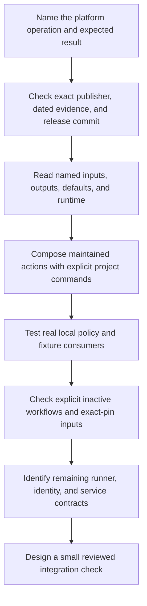

# Popular pre-built actions: less shell glue

**Module 7 · Lessons 0037–0042.** Select maintained actions for platform operations, compose their named interfaces, and keep project commands and authority decisions explicit. Continue after [security and reliability](0036-observability-concurrency-and-usage-budgets.md); the next module begins with [agentic workflow specifications](0043-agentic-markdown-and-compiled-workflows.md).

The [dated action catalog](../references/prebuilt-actions.md) is discovery evidence for a curated shortlist. It is historical, even when read on the same calendar date. Use its links to inspect current upstream identity, release behavior and interfaces before adoption. Stars measure popularity; a matched Marketplace creator badge concerns publisher identity; neither completes release review.

## Work through the six contracts

| Lesson | Runnable local work | Boundary retained for real integration |
| --- | --- | --- |
| [0037 · Select actions and verify publishers](0037-selecting-popular-prebuilt-actions.md) | Admission policy over dated selection records | Actual executable-release audit and effective authority |
| [0038 · Select jobs with paths-filter](0038-paths-filter-and-selective-jobs.md) | Consumer reads real output mappings with supplied action results | PR API, Git comparison, matcher and runner mapping |
| [0039 · Setup, caches and artifacts](0039-setup-cache-and-artifact-actions.md) | Real Node resolution/build and local file-integrity checks | Remote setup, actual install and hosted cache/artifact services |
| [0040 · Docker and cloud authentication](0040-docker-build-and-cloud-auth-actions.md) | Build-only YAML policy and synthetic intended-identity checks | Builder execution, registry access and signed provider exchange |
| [0041 · Release, PR and reporting effects](0041-release-pr-and-reporting-actions.md) | Intended-effect gate and bounded XML report consumer | GitHub writes, approval-required CI and external uploads |
| [0042 · Compose and maintain the pipeline](0042-compose-maintained-actions-and-manage-updates.md) | Exact-pin metadata check and actual workflow gate program | Remote dependency behavior, scheduling and hosted evidence |

Each reference lesson contains predictions, collapsed worked solutions, deliberate failures and transfer questions. The fixture programs exercise local policy and consumers. They do not replace the maintained actions whose upstream contracts they teach. Written content and assistant checks establish no learner mastery.

## Replace the repeated operation

| Repeated operation | Suitable maintained interface | Keep explicit |
| --- | --- | --- |
| Parse changed files and dispatch components | `dorny/paths-filter` | Comparison boundary, filter names and job-selection policy |
| Acquire a runtime and reuse package downloads | Setup-node or setup-uv | Tool/lockfile inputs and actual project install/test commands |
| Exchange results across isolated jobs | Upload/download-artifact | Producer, name, expected files, integrity and retention |
| Prepare a builder and export an image | Docker Buildx, metadata and build actions | Context, format, tags/labels, push policy and result checks |
| Acquire registry/cloud identity | Registry/vendor authentication action | Event trust, target identity, provider permissions and approval |
| Propose versions or generated changes | Release Please or reviewed PR action | Intended writes, generated-file boundary and review |
| Publish structured reports | A reviewed report/service action | Data provenance, schema, failure state and service authority |

A short application command can already be the right interface. Add a custom action when it provides a useful reusable contract or domain behavior, then use Module 9 to package and test that interface.



## Run only the intended local checks

Use the existing dependencies from the repository root. These commands do not install packages or execute remote actions:

```bash
.venv/bin/python -m unittest discover -s labs/0037 -p test_selection.py -v
.venv/bin/python -m unittest discover -s labs/0038 -p test_route.py -v
.venv/bin/python -m unittest discover -s labs/0039 -p test_contract.py -v
.venv/bin/python -m unittest discover -s labs/0040 -p test_policy.py -v
.venv/bin/python -m unittest discover -s labs/0041 -p test_effects.py -v
.venv/bin/python -m unittest discover -s labs/0042 -p test_maintenance.py -v
.venv/bin/python labs/0042/check_contracts.py
.tools/bin/actionlint -no-color \
  labs/0038/selective.yml \
  labs/0039/exchange.yml \
  labs/0040/build.yml \
  labs/0041/release.yml \
  labs/0042/pipeline.yml
```

The explicit positive list excludes `obsolete-input.negative.yml` and the non-workflow Dependabot proposal. Some lesson commands deliberately return exit 1 to diagnose rejected plans, missing dependencies or invalid evidence; keep those failures distinct from positive verification.

All new workflow recipes remain under `labs/`, where GitHub does not discover them as active workflows. Existing shared examples remain available as larger reference recipes. Inspect any proposed activation for its actual events, package installation, credentials, uploads and writes before a hosted exercise. A release-proposal action can still write a PR when release publication is disabled.

## Distinguish evidence boundaries

Host tests can prove that a real program rejected a missing module, mismatched name, invalid policy field or unsuccessful worker. Static lint checks structure and expressions; the metadata checker compares literal input names against saved exact-pin interfaces. Neither establishes that a downloaded action ran or that a real credential could access a service.

Container checks need an available engine and compatible builder. A selected `act` run can provide local wiring evidence, with its own runner/service limitations. GitHub authorization, fork policy, OIDC claims, environment protection, hosted caching/artifacts, downstream automation approvals and cancellation still need platform observations. Use the [local-testing guide](../cheatsheet/local-testing.md) to choose the smallest appropriate layer.

| Previous | All lessons | Next |
| --- | --- | --- |
| [0036 · Observability and usage budgets](0036-observability-concurrency-and-usage-budgets.md) | [Curriculum](index.md) | [0037 · Choose pre-built actions](0037-selecting-popular-prebuilt-actions.md) |
