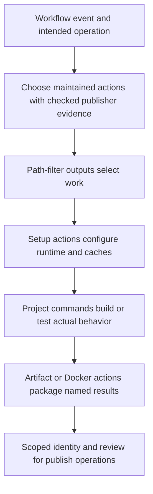

# Popular pre-built actions: less shell glue

Use maintained actions for common repository, setup, cache, build, artifact, identity, and release operations. Keep project-specific build and test commands explicit. This module teaches selection and composition before custom action implementation.

**Module 2 · Lessons 0049–0054.** Start after [workflow dependencies](0006-matrices-dependencies-and-cancellation.md). The [ranked catalog](../references/prebuilt-actions.md) contains **29 actions**, dated star counts, and observed Marketplace creator evidence. GitHub's [pre-written building blocks guide](https://docs.github.com/en/actions/how-tos/write-workflows/choose-what-workflows-do/find-and-customize-actions) explains how to reference an existing action.

## The six lessons

| Lesson | Planned coverage |
| --- | --- |
| [0049 · Choose popular pre-built actions and verify their publishers](0049-selecting-popular-prebuilt-actions.md) | Select an action using task fit, publisher evidence, release activity, and a dated star count. |
| [0050 · Replace git-diff shell logic with dorny/paths-filter](0050-paths-filter-and-selective-jobs.md) | Select jobs from named changed-path outputs without a custom git-diff pipeline. |
| [0051 · Use setup, cache, and artifact actions instead of bootstrap scripts](0051-setup-cache-and-artifact-actions.md) | Configure tools and download caches through maintained setup actions. |
| [0052 · Compose Docker build and cloud authentication actions](0052-docker-build-and-cloud-auth-actions.md) | Build and label an image using Docker-maintained actions instead of CLI glue scripts. |
| [0053 · Automate releases, pull requests, and reports with pre-built actions](0053-release-pr-and-reporting-actions.md) | Replace release and generated-change API scripts with explicit maintained action interfaces. |
| [0054 · Compose an action-based pipeline and maintain its dependencies](0054-compose-maintained-actions-and-manage-updates.md) | Replace reusable platform glue with pre-built actions while preserving explicit application commands. |

## Replace repeated platform work

| Repeated workflow glue | Prefer a suitable maintained action |
| --- | --- |
| Parse changed files with git, grep, and shell conditions | `dorny/paths-filter` and named job outputs |
| Download tools and maintain installer scripts | `actions/setup-node`, `actions/setup-python`, `astral-sh/setup-uv`, or `pnpm/action-setup` |
| Manually save dependency download directories | Setup action cache inputs, or `actions/cache` for an explicit custom cache |
| Archive, upload, locate, and download build outputs | `actions/upload-artifact` and `actions/download-artifact` |
| Construct Docker builder commands, tags, and registry login | Docker's setup, metadata, login, and build/push actions |
| Obtain temporary cloud credentials | Vendor-maintained AWS, Azure, or Google authentication actions with an explicit identity policy |
| Maintain release, generated PR, and report API glue | Release Please, a reviewed PR action, or a structured test-report action |

Choose an action because it simplifies a real contract. A short `npm test` command already exposes useful project behavior; wrapping every command in another dependency is not a goal.

## Start with the checked-in CI recipe

Source: [examples/prebuilt-actions/ci.yml](https://github.com/Rohit1024/actions-learn/blob/main/examples/prebuilt-actions/ci.yml).

The recipe selects a Node build and a documentation build with `dorny/paths-filter`. Its full commit pin was resolved from the named upstream release tag:

```yaml
- uses: dorny/paths-filter@ceb8a2b8f2d89434be7ff52d3de7ec3738c5cc9d # v4.0.3
  id: filter
  with:
    filters: |
      code:
        - 'examples/**'
        - 'package*.json'
      docs:
        - 'docs/**'
```

The actual file includes the complete filters, checkout, and job output mappings. For pull requests the action uses GitHub's changed-file API and needs `pull-requests: read`; branch/manual comparisons need the checked-out repository. Follow the [upstream documentation](https://github.com/dorny/paths-filter) when choosing a comparison base.

A dependent job compares the mapped output explicitly:

```yaml
needs: changes
if: github.event_name == 'workflow_dispatch' || needs.changes.outputs.code == 'true'
```

**Predict:** which jobs should run for code-only, documentation-only, mixed, and unrelated changes? Why should manual dispatch have an explicit policy? Try those cases in a reviewed GitHub exercise after local validation.

!!! note "Publisher identity and popularity"
    `dorny/paths-filter` is a community action; its matched Marketplace listing did not show a verified creator badge on 2026-10-30. The catalog records this separately from its stars. Prefer verified publishers for the core setup, cache, artifact, Docker, and cloud operations where suitable options exist. A creator badge establishes publisher identity, not a review of every release's code.

## Setup, caches, and artifacts

The Node job uses `actions/setup-node` with `cache: npm` and the lockfile path. It then runs `npm ci`, tests, and the project build. The cache stores dependency downloads; it does not provide an installed `node_modules` tree. The artifact actions then upload the action bundle and download it into an isolated consumer job. See [setup-node](https://github.com/actions/setup-node) and [upload-artifact](https://github.com/actions/upload-artifact).

The documentation job similarly uses `astral-sh/setup-uv` for Python/tool/cache setup, keeps the locked install and site build commands, and uploads a documentation preview. These examples replace platform glue while retaining application work.

## Container and release recipes

- [container-build.yml](https://github.com/Rohit1024/actions-learn/blob/main/examples/prebuilt-actions/container-build.yml) composes Docker's Buildx, metadata, and build actions, then uploads an OCI image archive. It uses `push: false`; registry publication is a separate exercise involving `docker/login-action` and intended publish permissions.
- [release-please.yml](https://github.com/Rohit1024/actions-learn/blob/main/examples/prebuilt-actions/release-please.yml) uses Google's verified Release Please action. Activating this recipe can create release pull requests and releases, so its job declares repository write permissions. Inspect its release configuration before enabling it. See the [upstream release contract](https://github.com/googleapis/release-please-action).
- The [catalog](../references/prebuilt-actions.md) also covers labels, test reporting, dependency review, coverage, CodeQL, Pages, and cloud identity. Optional community utilities retain their own publisher and permission decisions.



## Local feedback and hosted limits

The recipes are under `examples/`, so GitHub does not automatically run them. Read them first; activate only the chosen workflow and its intended events when doing the hosted exercise. The release recipe's writes are not performed by this documentation update.

From the repository root:

```bash
task lint:recipes
task test
```

Static checks validate workflow structure, expressions, and the local custom-action metadata. Direct tests exercise the existing domain implementations. They do not execute downloaded actions or prove API permissions, cache/artifact services, cloud trust, or release writes. A container recipe also needs a built-image check when you exercise that boundary.

**Failure exercise:** use a bare output string as a condition instead of comparing with `'true'`. Predict why the nonempty string `'false'` can produce the wrong selection. Repair the condition and explain the selected jobs.

**Retrieval:** name three pieces of shell glue removed by the recipes, explain why `npm ci` remains, and describe what evidence you need before updating an action pin.

| Previous | All lessons | Next |
| --- | --- | --- |
| [Workflow dependencies](0006-matrices-dependencies-and-cancellation.md) | [Curriculum](index.md) | [0049 · Choose pre-built actions](0049-selecting-popular-prebuilt-actions.md) |
