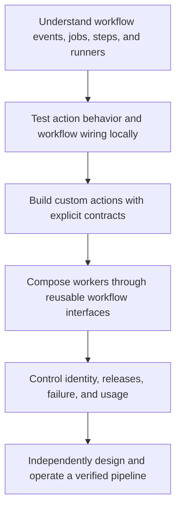

# Teaching guide: from workflows to an Actions orchestrator

Start directly with GitHub Actions and develop the ability to design, test, secure, release, and operate its automation. Use real workflows and custom actions to introduce events, jobs, steps, runners, expressions, and contracts. Explain supporting YAML, shell, language, and API details when the current example needs them. The learner has excluded standalone Linux and general programming lessons.

The course has [48 Actions lessons in 8 modules](index.md), starting at [0001 · The execution model](0001-execution-model.md). Each planned lesson is a brief for a future teaching thread. A written page does not establish that the material has been taught or understood.

## Start a lesson in a new thread

Open its page from the [curriculum](index.md), then copy its **Start this lesson in a new thread** prompt. The prompt identifies the exact file to expand. A new thread should read the mission, learner notes, this guide, and prerequisite pages before deciding where to begin.

For example:

```text
/teach 0001

Expand docs/lessons/0001-execution-model.md
using docs/lessons/teaching-guide.md. Read docs/mission.md and NOTES.md.
Start with events, workflows, jobs, steps, and runners, one concept at a time.
Ask me to predict and try examples before showing their solutions.
```

Use lesson IDs **0001–0048**, resolved through the curriculum. Expand the existing page in place so links and neighboring lessons remain stable.

## The progression



- **Modules 1–2:** configure events, runners, steps, expressions, outputs, and dependencies; build a fast local feedback loop.
- **Modules 3–5:** author Docker, JavaScript/TypeScript, and composite actions, then choose step-level or job-level reuse deliberately.
- **Modules 6–7:** reason about credentials, provenance, releases, failure, usage, and constrained agentic automation using real evidence.
- **Module 8:** build a capstone with workers, parallel branches, evidence joins, release gates, observability, and a recovery playbook.

## Check prerequisites without guessing proficiency

Begin with a short prediction or tiny exercise based on the lesson's Actions behavior and linked prerequisites. For lesson 0001, trace an event into a workflow and identify what a runner executes. Ask the learner to explain behavior rather than asking only whether they know a term.

If an Actions prerequisite is missing, explain the minimum needed and link the relevant earlier Actions lesson. Keep supporting syntax explanations brief and tied to the example. If the learner demonstrates a concept confidently, summarize and move on. The requested lesson does not establish actual proficiency.

For a Docker entrypoint, explain how arguments, environment values, output files, and exit status cross the action boundary. For a workflow expression, distinguish YAML structure, Actions expressions, and shell or JavaScript evaluation before combining them.

## Use this teaching sequence

1. **State a concrete goal.** Describe what the learner will build or explain and how success will be observed.
2. **Introduce one idea.** Define its vocabulary with a small example and explain the connection to known concepts. Include a diagram when a process, data exchange, or dependency is involved.
3. **Ask for a prediction.** Have the learner say what should happen before running code. Give them room to answer.
4. **Run the smallest example.** Explain the workflow or action interface, the selected local check, and its expected evidence. Clarify working directories, arguments, output channels, or exit status when they affect the contract.
5. **Change one thing.** Let the learner edit a value or condition and explain the changed behavior. Avoid presenting a large finished workflow before its pieces are understood.
6. **Introduce a deliberate failure.** Capture a reproducible symptom, trace the relevant boundary, and repair the cause. Preserve a meaningful regression check when executable behavior changes.
7. **Increase independence.** Move from guided imitation to a similar exercise, then an unfamiliar case or a design tradeoff. Ask the learner to justify the chosen interface, test layer, or policy.
8. **Retrieve and hand off.** Ask the lesson questions without immediately revealing answers. Record what was actually shown, what remains uncertain, and the next lesson.

Pause the live conversation at exercises and questions. A self-contained reference page can contain the full explanation, but the interactive session should give the learner opportunities to think and act before solutions are revealed. Put worked solutions after the exercise, preferably in a collapsed section.

## What a fully developed lesson should contain

Replace the placeholder note with its actual authored status, preserving its ID and file path. Develop its existing brief into:

- Clear prerequisites, a concrete goal, and observable outcomes.
- Explanations of Actions behavior with definitions at first use and links to relevant prerequisite lessons.
- Small runnable workflows or action examples with relevant YAML, code, commands, and expected results explained in context.
- A vertical Mermaid diagram showing the actual execution, dependency, or trust boundaries. Refine the placeholder planning diagram; show parallel branches and evidence joins when teaching orchestration.
- A local exercise under its planned `labs/<lesson-id>/` directory, or a focused extension of an existing example. Create files only when the exercise is developed; do not link to nonexistent artifacts.
- A deliberate failure, a diagnosis method, and a corrected result.
- Retrieval questions, a transfer exercise, and an explanation of remaining verification limits.
- Relevant primary references, checked for current runtime versions and tool syntax.
- The existing previous/catalog/next links, updated only when an actual neighboring page changes.

Use [primary references](../references/resources.md). Teach the small example first, then explain when a realistic repository needs a different interface, stronger validation, or a platform integration check.

## Keep the feedback loop local and small

Inspect the available environment before installing tools. Reuse the project's locked dependencies and task commands; avoid reinstalling packages on each teaching step.

For prose and lesson edits, run `task docs:verify` once after the edit batch. Its link check covers the whole site; diagram validation reuses successful unchanged renders; the build is incremental. Use a forced render or clean build when the change or diagnosis calls for it.

If a lesson changes executable examples, select the smallest meaningful direct test and static check. Add a container or selected `act` smoke test when that execution boundary changes. Explain why real token permissions, OIDC, environment protection, hosted services, or the target runner matrix still require GitHub evidence.

For Agentic Workflows, keep local compilation, deterministic fixture tests, model evaluation, and hosted trials distinct. Record which boundary was exercised and any runner or model usage. An unexecuted example or successful compile must not be reported as a successful live agent run.

## Authored content and demonstrated understanding

Page metadata describes its publication state:

- `lesson_status: placeholder`: a teaching plan awaiting a developed lesson.
- `lesson_status: starter`: existing introductory content awaiting a fuller guided session.
- `lesson_status: authored`: a developed reference lesson with its examples and exercises.

Curriculum checkboxes track available written content. A generated or authored page does not establish learner mastery. Record understanding only from actual learner statements, code, explanations, or debugging evidence. Keep open questions and failed attempts visible rather than converting them into completed outcomes.

When a placeholder is developed, update its metadata, the corresponding curriculum checkbox, and the authored/placeholder counts in the course introduction and learner notes. If only part of a lesson is taught, say so in the handoff.

## Handoff after each lesson

Persist enough state for a new thread to continue without conversation history:

```text
Lesson ID and file:
Page status and sections developed:
Learner-produced example and explanation:
Failure reproduced and repair explained:
Checks actually executed and their results:
Checks deferred or blocked, with the reason:
Misconceptions or questions still open:
Learning record, if justified by actual evidence:
Next lesson ID and prerequisite gaps:
```

Update `NOTES.md` with the current session state. Add a learning record only when there is genuine evidence or an explicit statement worth retaining. Do not manufacture a completed session while expanding a page from its teaching brief.

## What professional orchestration means here

By the capstone, the learner should independently explain and build a job graph with appropriate runners, bounded credentials, explicit worker inputs and outputs, intentional parallelism, and a join that rejects missing required evidence. They should choose tests for the relevant boundaries, package and version an action, diagnose failures from observable results, and justify a release decision.

They should also explain cancellation and recovery after partial work, dependency updates, cache validity, artifact provenance, operator diagnostics, and usage limits. Agentic reporting should remain grounded in verifiable worker evidence and an explicit output policy. The goal is defensible engineering judgment as well as working YAML.

[Start with the execution model](0001-execution-model.md) · [All lessons](index.md) · [Mission](../mission.md)
