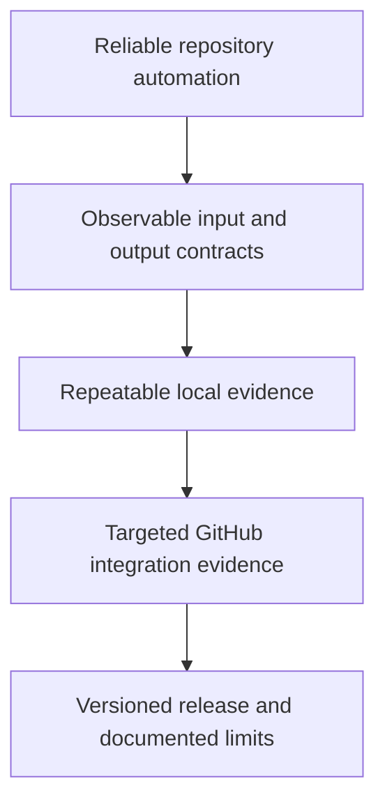

# Mission: ship reliable GitHub Actions with fast local feedback

## Why

Start directly with GitHub Actions workflows, jobs, steps, runners, and events, then progress to independently designing, testing, securing, and operating workflow orchestration. Build and maintain custom actions with a reusable local testing workflow, then use GitHub-hosted integration runs deliberately, including bounded GitHub Agentic Workflows.

## Success looks like

- Explain how an event becomes a workflow run, jobs, steps, and action processes.
- Configure triggers, expressions, inputs, outputs, dependencies, and reusable workflows with explicit contracts.
- Select maintained pre-built actions using task fit, dated popularity, publisher evidence, and reviewed release references; reduce repeated shell glue.
- Implement and test Docker container, JavaScript, TypeScript, and composite actions with documented inputs and outputs.
- Run the same core checks from a local Taskfile and CI, and reproduce failures with fixtures.
- Identify where `act` differs from GitHub, including token permissions, OIDC, environments, concurrency, and runner images.
- Compile a GitHub Agentic Workflow, inspect its generated workflow, and evaluate its behavior with bounded tools and outputs.
- Release a versioned action and publish this learning site through GitHub Pages.
- Own a multi-job orchestrator with explicit worker contracts, parallel execution, evidence joins, release gates, diagnostics, usage limits, and a recovery plan.

## Constraints

- Prefer maintained actions for common platform operations. Keep necessary project commands explicit and create custom actions for reusable interfaces or missing domain behavior.
- Prefer host tests and deterministic fixtures before containers or hosted runs.
- Preserve GitHub Actions minutes and AI usage by selecting the smallest useful test.
- Teach through runnable examples, retrieval exercises, and vertical Mermaid diagrams.
- Use current primary documentation for runtime versions and the evolving `gh aw` CLI.
- Treat initial proficiency as unknown; record demonstrated understanding during `/teach` sessions.
- Begin at the GitHub Actions execution model. Explain YAML, shell, language, and API details briefly when an action or workflow needs them.
- Develop one planned lesson per future teaching thread, using its existing page, prerequisites, exercises, and handoff prompt.

## Out of scope

Standalone Linux, terminal, Git, and general programming lessons are outside this course, as requested by the learner. Kubernetes operators, a general agent framework, and a multi-cloud deployment platform are follow-on topics if the mission changes.

[Home](index.md) · [Curriculum](lessons/index.md)
