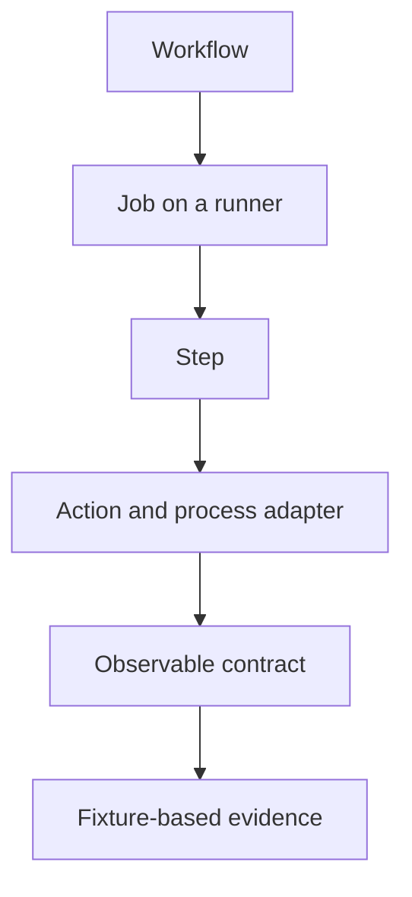

# GitHub Actions working glossary

These starter definitions support the written material. They do not assert that the learner has mastered the terms. During `/teach`, record demonstrated understanding separately and refine this vocabulary when needed.

## Workflow execution

**Workflow**: An event-triggered definition of jobs, their dependencies, and execution configuration.

**Workflow run**: One execution of a workflow for an event and revision.

**Job**: A set of steps assigned to a runner, with its own environment and declared dependencies.

**Step**: An ordered command or action invocation within a job.

**Runner**: The host and runner process that execute a job. A Docker action can start a separate container on that host.

**Action**: A reusable step-level component described by an `action.yml` or `action.yaml` metadata file.

**Reusable workflow**: A workflow invoked through `workflow_call`, providing job-level reuse and orchestration.

**Context**: A named source of values available to GitHub's expression evaluator, such as `github`, `inputs`, `steps`, or `needs`.

## Actions and testing

**Docker container action**: An action whose program runs in a Linux container built from a Dockerfile or selected image.

**JavaScript action**: An action whose entrypoint is JavaScript executed by the Node runtime selected in metadata. TypeScript-authored actions distribute compiled JavaScript through this mechanism.

**Composite action**: An action that groups steps into one step-level interface in a caller's job.

**Output file protocol**: The runner interface that reads named values appended to the file identified by `GITHUB_OUTPUT`.

**Process adapter**: Code that translates runtime inputs and environment variables into application calls, output files, logs, and exit status.

**Fixture**: Controlled input data used to reproduce a scenario, such as a synthetic event JSON or a small repository tree.

**Contract test**: A test of externally observable behavior, such as accepted inputs, output contents, or failure exit status.

**act**: A local workflow execution tool that approximates selected GitHub Actions runner behavior, usually using containers.

**Taskfile**: A YAML definition of named commands for the Task runner. It can share a command interface between local development and CI.

**Distribution bundle**: The executable artifact shipped to action consumers, such as the compiled TypeScript entrypoint in `dist/`.

## Security and agentic automation

**GITHUB_TOKEN**: A GitHub-issued workflow credential whose effective permissions depend on workflow/job configuration and platform policy.

**OIDC**: OpenID Connect, used here to exchange a workflow identity for short-lived access through a trusted identity provider relationship.

**Trust boundary**: A point where data, code, identity, or authority crosses between parties or execution contexts with different privileges.

**GitHub Agentic Workflow**: A Markdown-defined automation compiled by `gh aw` into a GitHub Actions workflow that runs a configured agent engine.

**Lock workflow**: The generated `.lock.yml` Actions definition associated with an agentic Markdown workflow source.

**Safe output**: A configured structured operation processed by an output handler, with explicit policy and limits, rather than unconstrained direct mutation by the agent.

**Staged output**: A preview of configured safe-output operations that leaves those operations unpublished. Agent execution can still use remote services and incur usage.

[Reference library](index.md) · [Resources](resources.md)
