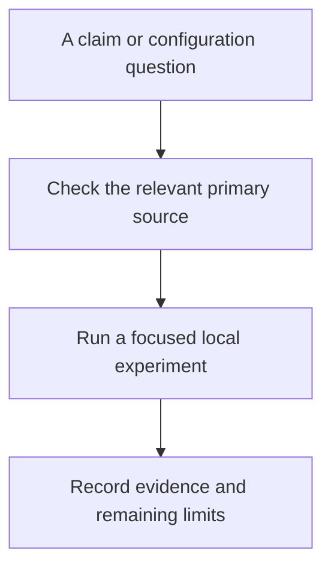

# GitHub Actions reference library

Use primary documentation to check syntax, security boundaries, runtime support, and the evolving GitHub Agentic Workflows CLI.

- [Curated resources](resources.md): annotated official documentation and maintainer communities.
- [Working glossary](glossary.md): terms used in the starter material; understanding is tracked separately during teaching.
- [Command cheatsheet](../cheatsheet/index.md): commands and data-flow syntax for quick retrieval.

[Home](../index.md) · [Curriculum](../lessons/index.md)
