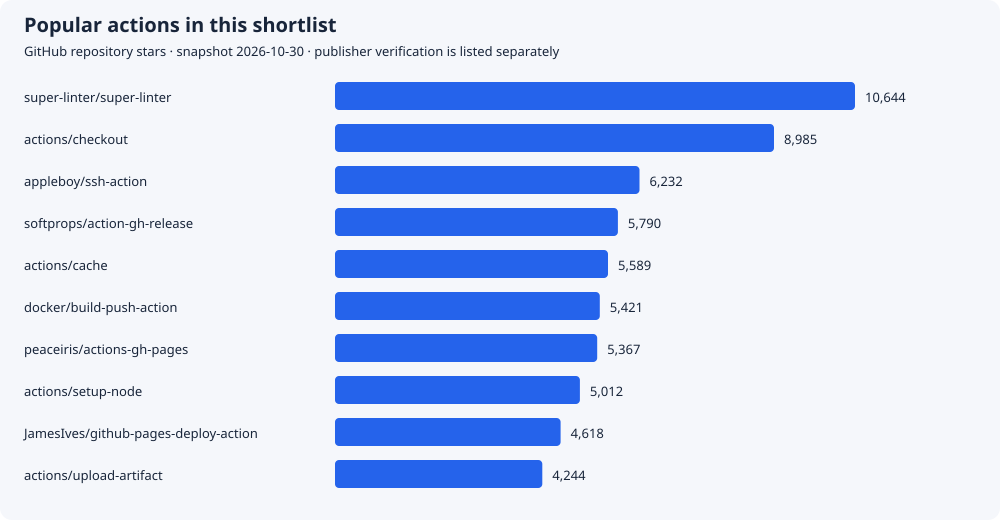
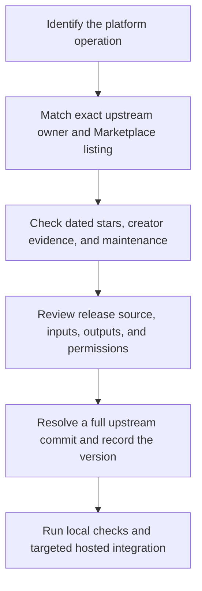

# Popular pre-built actions: dated selection catalog

**Checked 2026-10-30.** This catalog ranks 29 selected action repositories by GitHub stars. It is a shortlist for the course, not a complete Marketplace ranking. All selected repositories were non-archived when checked; the [saved snapshot](actions-snapshot.json) records star counts, last pushes, repository releases, and matched Marketplace evidence.

!!! note "What verified means"
    The Marketplace badge identifies a creator verified by GitHub as a partner organization. GitHub states Marketplace actions can be published without a code review. Keep publisher identity, popularity, reviewed source, release maintenance, and permission requirements separate. See [GitHub's badge explanation](https://docs.github.com/en/actions/how-tos/create-and-publish-actions/publish-in-github-marketplace#about-badges-in-github-marketplace).

## Ranked shortlist

Stars belong to repositories, including multi-action repositories such as CodeQL. **Badge not observed** means the matched listing did not show the creator badge during this check; it is not a claim about the code's quality. CodeQL is recorded as GitHub-maintained without inventing a Marketplace badge claim.

| Action repository | Stars | Publisher evidence | Replaces or simplifies |
| --- | ---: | --- | --- |
| [super-linter/super-linter](https://github.com/super-linter/super-linter) | 10,644 | [Verified creator](https://github.com/marketplace/actions/super-linter) | Run a configured collection of source linters |
| [actions/checkout](https://github.com/actions/checkout) | 8,985 | [Verified creator](https://github.com/marketplace/actions/checkout) | Check out the requested repository revision |
| [appleboy/ssh-action](https://github.com/appleboy/ssh-action) | 6,232 | [Badge not observed](https://github.com/marketplace/actions/ssh-remote-commands) | Run explicitly reviewed remote commands over SSH |
| [softprops/action-gh-release](https://github.com/softprops/action-gh-release) | 5,790 | [Badge not observed](https://github.com/marketplace/actions/gh-release) | Attach release files without custom API upload loops |
| [actions/cache](https://github.com/actions/cache) | 5,589 | [Verified creator](https://github.com/marketplace/actions/cache) | Restore and save dependency or tool caches |
| [docker/build-push-action](https://github.com/docker/build-push-action) | 5,421 | [Verified creator](https://github.com/marketplace/actions/build-and-push-docker-images) | Build, cache, and optionally publish container images |
| [peaceiris/actions-gh-pages](https://github.com/peaceiris/actions-gh-pages) | 5,367 | [Badge not observed](https://github.com/marketplace/actions/github-pages-action) | Publish generated files to a Pages branch |
| [actions/setup-node](https://github.com/actions/setup-node) | 5,012 | [Verified creator](https://github.com/marketplace/actions/setup-node-js-environment) | Install Node and configure package-manager caching |
| [JamesIves/github-pages-deploy-action](https://github.com/JamesIves/github-pages-deploy-action) | 4,618 | [Badge not observed](https://github.com/marketplace/actions/deploy-to-github-pages) | Publish generated files to a deployment branch |
| [actions/upload-artifact](https://github.com/actions/upload-artifact) | 4,244 | [Verified creator](https://github.com/marketplace/actions/upload-a-build-artifact) | Upload build results without archive/upload scripts |
| [dorny/paths-filter](https://github.com/dorny/paths-filter) | 3,381 | [Badge not observed](https://github.com/marketplace/actions/paths-changes-filter) | Select jobs from changed paths without custom git-diff parsing |
| [aws-actions/configure-aws-credentials](https://github.com/aws-actions/configure-aws-credentials) | 3,018 | [Verified creator](https://github.com/marketplace/actions/configure-aws-credentials-action-for-github-actions) | Configure short-lived AWS credentials through OIDC |
| [peter-evans/create-pull-request](https://github.com/peter-evans/create-pull-request) | 2,872 | [Badge not observed](https://github.com/marketplace/actions/create-pull-request) | Create or update a pull request from generated changes |
| [googleapis/release-please-action](https://github.com/googleapis/release-please-action) | 2,560 | [Verified creator](https://github.com/marketplace/actions/release-please-action) | Propose version and changelog changes through release PRs |
| [actions/labeler](https://github.com/actions/labeler) | 2,512 | [Verified creator](https://github.com/marketplace/actions/labeler) | Apply path-based pull-request labels |
| [actions/setup-python](https://github.com/actions/setup-python) | 2,244 | [Verified creator](https://github.com/marketplace/actions/setup-python) | Select Python without manual installer scripts |
| [actions/download-artifact](https://github.com/actions/download-artifact) | 1,920 | [Verified creator](https://github.com/marketplace/actions/download-a-build-artifact) | Download named results for dependent jobs |
| [codecov/codecov-action](https://github.com/codecov/codecov-action) | 1,717 | [Verified creator](https://github.com/marketplace/actions/codecov) | Upload coverage reports to Codecov |
| [github/codeql-action](https://github.com/github/codeql-action) | 1,668 | GitHub-maintained; Marketplace badge not assessed | Run CodeQL analysis and publish code-scanning results |
| [docker/login-action](https://github.com/docker/login-action) | 1,497 | [Verified creator](https://github.com/marketplace/actions/docker-login) | Authenticate to an image registry |
| [google-github-actions/auth](https://github.com/google-github-actions/auth) | 1,412 | [Verified creator](https://github.com/marketplace/actions/authenticate-to-google-cloud) | Authenticate to Google Cloud through workload identity |
| [docker/setup-buildx-action](https://github.com/docker/setup-buildx-action) | 1,391 | [Verified creator](https://github.com/marketplace/actions/docker-setup-buildx) | Configure the Buildx builder |
| [pnpm/action-setup](https://github.com/pnpm/action-setup) | 1,323 | [Badge not observed](https://github.com/marketplace/actions/setup-pnpm) | Install pnpm without a custom bootstrap script |
| [dorny/test-reporter](https://github.com/dorny/test-reporter) | 1,184 | [Badge not observed](https://github.com/marketplace/actions/test-reporter) | Publish structured test reports as checks |
| [docker/metadata-action](https://github.com/docker/metadata-action) | 1,154 | [Verified creator](https://github.com/marketplace/actions/docker-metadata-action) | Generate image tags and OCI labels |
| [actions/deploy-pages](https://github.com/actions/deploy-pages) | 965 | [Verified creator](https://github.com/marketplace/actions/deploy-github-pages-site) | Deploy the generated GitHub Pages artifact |
| [actions/dependency-review-action](https://github.com/actions/dependency-review-action) | 930 | [Verified creator](https://github.com/marketplace/actions/dependency-review) | Review dependency changes in pull requests |
| [astral-sh/setup-uv](https://github.com/astral-sh/setup-uv) | 897 | [Verified creator](https://github.com/marketplace/actions/astral-sh-setup-uv) | Install uv and configure its cache |
| [Azure/login](https://github.com/Azure/login) | 564 | [Verified creator](https://github.com/marketplace/actions/azure-login) | Authenticate to Azure through a declared identity |

## Prioritize the important operations

- **Core repository and runtime setup:** `actions/checkout`, `actions/setup-node`, `actions/setup-python`, and `astral-sh/setup-uv` have observed creator badges. Use setup action cache inputs before writing tool installers or cache save/restore scripts.
- **Caches and artifacts:** `actions/cache`, `actions/upload-artifact`, and `actions/download-artifact` have observed creator badges. Define cache validity and artifact names explicitly.
- **Container packaging:** Docker's setup, login, metadata, and build actions have observed creator badges. Keep registry authentication separate from a build-only preview.
- **Cloud identity and releases:** the AWS, Azure, Google authentication entries and Google's Release Please listing have observed creator badges. Their write or identity permissions still require an explicit contract.
- **Community utilities:** `dorny/paths-filter`, `dorny/test-reporter`, `peter-evans/create-pull-request`, and `softprops/action-gh-release` are useful options with no creator badge observed in their matched listings. Review each upstream release and its required permissions before use.
- **Optional deployment alternatives:** the SSH and Pages-branch entries are included for their popularity and task fit. For this site's current artifact-based Pages deployment, use the existing GitHub-maintained Pages actions.

## Selection and update workflow

The [snapshot JSON](actions-snapshot.json) links to each repository's API source and Marketplace listing. Recheck both when updating the catalog. A repository's latest release can describe a bundled tool rather than the action itself; choose action references from the actual action metadata and release history. Recipe commits were verified against upstream release tags and retain readable version comments; inspect their behavior before enabling the hosted exercises.

Prefer the action that fits the required interface with manageable maintenance and authority. Adding another action for a trivial command can increase dependencies without simplifying the workflow. The [pre-built module](../lessons/prebuilt-actions.md) shows where action reuse helps, and the [custom-action module](../lessons/create-your-own-action.md) covers requirements that need your own interface or behavior.

| Previous | Catalog | Next |
| --- | --- | --- |
| [Primary resources](resources.md) | [Reference library](index.md) | [Glossary](glossary.md) |
