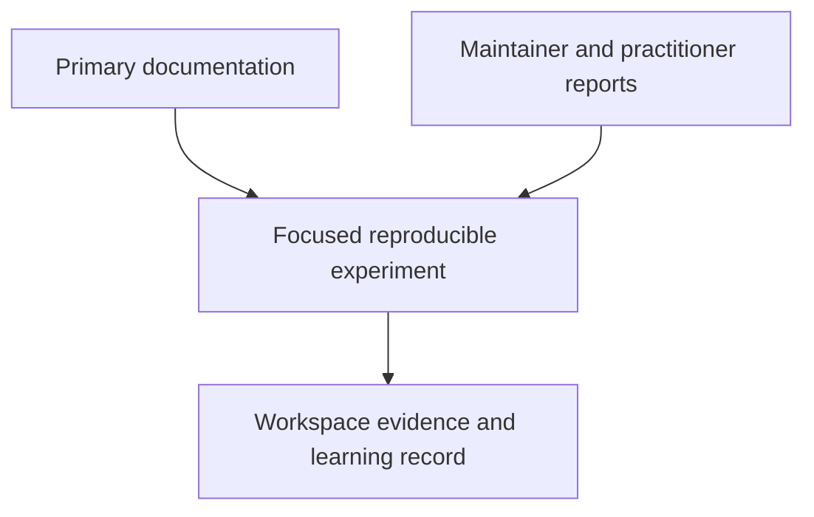

# GitHub Actions resources

Initial source check: **2026-10-30**. Prefer the installed tool's help when an online page documents a newer release. Runtime and release details should be rechecked when updating the labs.

## Knowledge

### Action implementation references

- [MDN JavaScript Guide](https://developer.mozilla.org/en-US/docs/Web/JavaScript/Guide) — Language behavior relevant to JavaScript action entrypoints, validation, and asynchronous API calls. Consult the needed section while implementing an action.
- [TypeScript Handbook](https://www.typescriptlang.org/docs/handbook/intro.html) — Type checking and typed interfaces. Use when defining action contracts and explaining source/build/runtime distinctions.
- [Pro Git](https://git-scm.com/book/en/v2) — Branches, tags, and shared development. Use when discussing action versioning and release practices.
- [MDN HTTP overview](https://developer.mozilla.org/en-US/docs/Web/HTTP/Guides/Overview) — Request/response contracts. Use when implementing and testing GitHub API adapters.
- [Python 3.14 tutorial](https://docs.python.org/3.14/tutorial/) — Language reference for the Docker action's Python entrypoint. Consult only the syntax needed for that action's input, output, and failure behavior.

### GitHub Actions and custom actions

- [Workflow syntax](https://docs.github.com/en/actions/reference/workflows-and-actions/workflow-syntax) — Events, jobs, expressions, permissions, matrices, and workflow reuse. Use when validating orchestration.
- [Action metadata syntax](https://docs.github.com/en/actions/reference/workflows-and-actions/metadata-syntax) — Inputs, outputs, and the Docker, Node, and composite execution formats. Use when designing an action contract.
- [Workflow commands](https://docs.github.com/en/actions/reference/workflows-and-actions/workflow-commands) — Output/environment files, multiline values, annotations, and summaries. Use when building adapters.
- [Docker container action tutorial](https://docs.github.com/en/actions/tutorials/use-containerized-services/create-a-docker-container-action) — Dockerfiles, arguments, entrypoints, and workspace access. Use for the Docker action lessons.
- [JavaScript action tutorial](https://docs.github.com/en/actions/tutorials/create-actions/create-a-javascript-action) — Node metadata and the Actions Toolkit. Use for the JavaScript action lessons.
- [TypeScript action template](https://github.com/actions/typescript-action) — Maintained packaging and testing patterns. Use when extending the minimal TypeScript lab.
- [Composite action tutorial](https://docs.github.com/en/actions/tutorials/create-actions/create-a-composite-action) — Input transport, shell steps, and output mapping. Use for the composite action lessons.
- [Secure use reference](https://docs.github.com/en/actions/reference/security/secure-use) — Untrusted input, token scope, action references, and supply-chain concerns. Use for security reviews.
- [OpenID Connect](https://docs.github.com/en/actions/concepts/security/openid-connect) — Federated identity and short-lived cloud credentials. Use when planning hosted identity checks.
- [GitHub Pages custom workflows](https://docs.github.com/en/pages/getting-started-with-github-pages/using-custom-workflows-with-github-pages) — Build artifacts, deployment jobs, and required permissions. Use when publishing this portal.

### Pre-built action selection and composition

- [GitHub: pre-written building blocks](https://docs.github.com/en/actions/how-tos/write-workflows/choose-what-workflows-do/find-and-customize-actions) — Action references, discovery, and version selection. Use before writing platform glue.
- [Marketplace publication and badges](https://docs.github.com/en/actions/how-tos/create-and-publish-actions/publish-in-github-marketplace) — Standalone action packaging and verified creator meaning. Use for publisher evidence and your own release plan.
- [Dated 29-action catalog](prebuilt-actions.md) and [source snapshot](actions-snapshot.json) — Repository stars, activity, upstream release information, and matched Marketplace listings checked on 2026-10-30. Each record links its primary sources.
- [dorny/paths-filter](https://github.com/dorny/paths-filter) — Named changed-path outputs and event-dependent permissions. Use for selective jobs without a custom diff script.
- [actions/setup-node](https://github.com/actions/setup-node), [actions/cache](https://github.com/actions/cache), [upload-artifact](https://github.com/actions/upload-artifact), and [download-artifact](https://github.com/actions/download-artifact) — Runtime/cache inputs and named artifact exchange. Use for setup and data movement recipes.
- [Docker build/push](https://github.com/docker/build-push-action), [Buildx setup](https://github.com/docker/setup-buildx-action), [image metadata](https://github.com/docker/metadata-action), and [registry login](https://github.com/docker/login-action) — Vendor-maintained container interfaces. Use to separate image building from publication.
- [Google Release Please action](https://github.com/googleapis/release-please-action) — Release PRs and version/changelog automation. Use with explicit repository write permissions and deliberate activation.

### Local tools

- [Task guide](https://taskfile.dev/docs/guide/) — Command orchestration, variables, preconditions, and dependencies. Use when extending the shared local/CI contract.
- [actionlint](https://github.com/rhysd/actionlint) — Maintainer documentation for workflow syntax and expression checks. Use before executing workflows.
- [ShellCheck](https://www.shellcheck.net/) — Shell diagnostics and explanations. Use when extracting or reviewing shell steps.
- [zizmor](https://docs.zizmor.sh/) — GitHub Actions security analysis. Use in the security module alongside functional checks.
- [act usage](https://nektosact.com/usage/index.html) — Event selection, job targeting, fixtures, secrets, and flags. Use for selected local smoke runs.
- [act runner images](https://nektosact.com/usage/runners.html) — Local image choices and differences from hosted runners. Use for architecture and tool-availability issues.
- [act limitations](https://nektosact.com/not_supported.html) — Unsupported or ignored platform behavior. Use to decide which checks remain hosted.
- [act container engines](https://nektosact.com/usage/custom_engine.html) — Docker-compatible engine/socket configuration. Use for Podman troubleshooting.
- [Node test runner](https://nodejs.org/api/test.html) — Built-in unit tests and assertions. Use for the JavaScript lab.
- [esbuild API](https://esbuild.github.io/api/) — Deterministic Node-targeted bundling. Use for the TypeScript distribution check.

### GitHub Agentic Workflows

- [GitHub's agentic workflow tutorial](https://docs.github.com/en/actions/tutorials/develop-agentic-workflows-in-github-actions) — Product workflow, CLI setup, and engine authentication. Use for the initial model.
- [gh-aw project](https://github.com/github/gh-aw) — Releases and implementation. Use to check the version in your environment.
- [CLI reference](https://github.github.com/gh-aw/setup/cli/) — Compilation, validation, hosted trial, and execution commands. Use before running a live trial.
- [Compilation process](https://github.github.com/gh-aw/reference/compilation-process/) — Source/lock behavior, validation modes, and compilation limits. Use for local checks.
- [Frontmatter](https://github.github.com/gh-aw/reference/frontmatter/) — Workflow configuration schema. Use when changing the example.
- [Tools](https://github.github.com/gh-aw/reference/tools/) — Tool access and allowlists. Use when deciding what an agent can actually do.
- [Safe outputs](https://github.github.com/gh-aw/reference/safe-outputs/) — Structured operations, limits, and staging. Use before enabling published changes.

### Teaching site

- [Zensical](https://zensical.org/docs/) — Configuration, authoring, diagrams, and deployment. Use when maintaining the portal.
- [uv](https://docs.astral.sh/uv/) — Python environments and locked dependency workflows. Use for reproducible builds.
- [Mermaid CLI](https://github.com/mermaid-js/mermaid-cli) — Rendering and syntax validation. Use when diagnosing the diagram checker.

## Wisdom (Communities)

- [GitHub Community: Actions](https://github.com/orgs/community/discussions/categories/actions) — Practitioner questions and platform edge cases. Verify proposed fixes against official docs and a reproducer.
- [act discussions](https://github.com/nektos/act/discussions) — Maintainer and user reports about local emulation. Use for runner-image and engine issues.
- [gh-aw discussions](https://github.com/github/gh-aw/discussions) — Evolving usage patterns and release feedback. Check whether advice matches your installed version.

[Reference library](index.md) · [Glossary](glossary.md)
